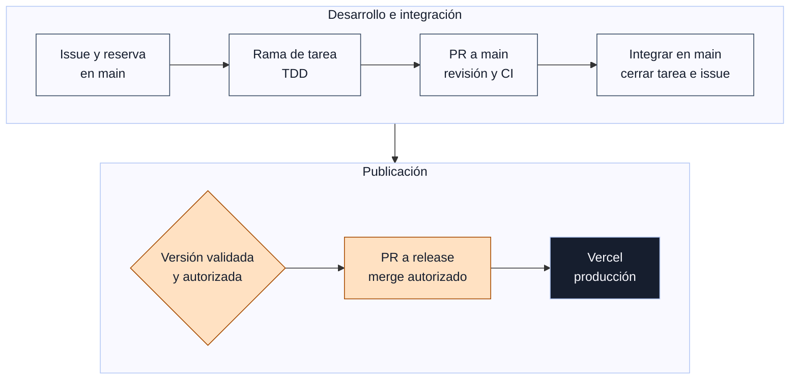

# Opinión — red social de encuestas

Repositorio del MVP. **El desarrollo se reanudó el 26-10-2026 (D-013)** y se avanza tarea a tarea según `docs/orden-ejecucion.md`; **Codex /root (opinion_social_media) se encarga de Vercel** (D-VERCEL-001). Las tareas se coordinan desde el estado actualizado de `main`; sus dependencias y las reservas de otros agentes siguen vigentes.

## Cómo trabajamos

**[Ver el flujo de trabajo completo: tareas, agentes, entornos y publicación →](docs/flujo-trabajo.md)**



**Desarrollo en dev; pruebas automáticas en Supabase/PostgreSQL efímeros locales o de CI. `main` no despliega la web.** Vercel sólo publica `release`; las previews están desactivadas. El [registro de tareas](docs/tareas-futuras.md) y el [canal de agentes #73](https://github.com/migdlp/opinion-social-media/issues/73) muestran el trabajo y los bloqueos actuales.

## Documentación

- [Diagrama y flujo de trabajo](docs/flujo-trabajo.md)
- [Índice y forma de trabajar](docs/README.md)
- [Contexto de producto](docs/contexto-aplicacion.md)
- [Dirección creativa vigente: After Sunset](docs/direccion-creativa.md) · [Sistema de diseño](DESIGN.md)
- [Documentación técnica: mapa del código actual](docs/tecnica/README.md)
- [Arquitectura y contratos previstos](docs/arquitectura.md)
- [Brief de producto consolidado](docs/brief-producto.md)
- [Backlog revisado: 53 tareas y criterios de aceptación](docs/backlog.md)
- [Cobertura de las 27 agrupaciones y 16 casos límite](docs/cobertura-brief.md)
- [Épicas y tareas en GitHub Issues](docs/github-issues.md)
- [Backlog importable JSON](docs/backlog.json) · [CSV](docs/backlog.csv)
- [Plan de trabajo y estado de las tareas](docs/tareas-futuras.md)
- [Auditoría de cobertura y tareas añadidas](docs/auditoria-tareas.md) · [Backlog adicional](docs/backlog-adicional.md)
- [Prioridades, orden recomendado y siguiente tarea](docs/orden-ejecucion.md)
- [Accesos, recursos creados y verificaciones](docs/estado-proyecto.md)
- [Supabase: conexión de colaboradores y agentes](docs/supabase-acceso.md)
- [Vercel: responsable, entornos y operación](docs/vercel-operacion.md)
- [Decisiones y cuestiones pendientes](docs/decisiones.md)
- [Skill karpathy-guidelines](docs/skills.md)

## Stack y arquitectura

- **Next.js 16** (App Router, `cacheComponents`), React 19 y TypeScript estricto; Tailwind CSS 4. Next 16 cambia APIs respecto a versiones anteriores: leer `node_modules/next/dist/docs/` antes de tocar convenciones (p. ej. `middleware` pasó a `proxy`).
- **Supabase** (PostgreSQL, Auth con Google, RLS). La autorización vive en la base de datos: ningún usuario, tampoco el autor, obtiene agregados de una encuesta antes de votar. Contratos en [arquitectura](docs/arquitectura.md) y [contratos-api](docs/contratos-api.md); permisos de las RPC en [seguridad-rpc](docs/seguridad-rpc.md).
- **Vercel** para despliegue; Vitest + Testing Library para pruebas; GitHub Actions como CI.

Flujo de datos: los Server Components y las Server Actions leen y escriben con el cliente de `src/lib/supabase/server.ts` (sesión en cookies); el navegador usa `client.ts`. `src/proxy.ts` renueva la sesión en cada petición, `/auth/callback` canjea el código de Google y `/login` ofrece el acceso. Toda la lógica de datos pasa por los adaptadores de `src/lib/data/operations.ts`, que devuelven `Result<T>` y nunca lanzan.

## Desarrollo local

Requiere Node.js 22 (o ≥ 20.9) y npm. No hace falta Docker salvo para los tests de base de datos, de ataques y E2E (ver más abajo).

```bash
cp .env.example .env.local   # y completar la Publishable key de desarrollo (docs/entornos.md)
npm ci                       # instala dependencias exactas del lockfile
npm run check:env            # comprueba que .env.local apunta al Supabase de desarrollo
npm run dev                  # http://localhost:3000
npm run check                # lo que debe pasar antes de subir cambios
```

### Variables de entorno

Sólo hay dos, ambas públicas por diseño (la seguridad la imponen RLS y las RPC):

| Variable | Valor |
|---|---|
| `NEXT_PUBLIC_SUPABASE_URL` | URL del proyecto Supabase del entorno |
| `NEXT_PUBLIC_SUPABASE_PUBLISHABLE_KEY` | Publishable key (`sb_publishable_…`) del mismo proyecto |

Desarrollo local y pruebas manuales alojadas usan `opinion-social-media-dev`; las suites automáticas usan Supabase/PostgreSQL efímeros en localhost, también en CI. Producción usa `opinion-social-media-prod`. Preview conserva configuración de dev, pero los despliegues de preview están desactivados. Nunca se guardan en Git claves secretas, `service_role` ni contraseñas: ver [entornos](docs/entornos.md) y [acceso a Supabase](docs/supabase-acceso.md).

### Scripts

| Script | Qué hace |
|---|---|
| `npm run check` | Todo lo siguiente en orden; es lo que debe pasar antes de subir cambios |
| `npm run format:check` / `npm run format` | Prettier: comprueba / corrige el formato |
| `npm run lint` | ESLint (reglas de Next.js y TypeScript) |
| `npm run typecheck` | Genera tipos de rutas (`next typegen`) y ejecuta `tsc --noEmit` en modo estricto |
| `npm run test` | Tests unitarios con Vitest (`src/**/*.test.{ts,tsx}`) |
| `npm run build` | Compilación de producción |
| `npm run test:db` | Aplica `supabase/migrations` a un PostgreSQL local vacío y ejecuta `supabase/tests` (necesita `psql` y `PGHOST`/`PGPORT`/`PGUSER`; no toca Supabase) |
| `npm run test:db:concurrency` | Tras `test:db`: 10 peticiones simultáneas de la misma cuenta a `create_poll` (cuota) y `vote_poll` (voto único) |
| `npm run test:security` | Ataques HTTP a RLS, Auth y GraphQL contra una pila Supabase **local** (necesita Docker; la CI lo ejecuta sola) |
| `npm run test:e2e` | E2E con Playwright (escritorio y móvil) sobre la app compilada y una pila Supabase **local**: visitante, creación, voto y recarga; cortes de red tras escribir, envíos duplicados, pestañas simultáneas y recorrido accesible de rutas (MVP-045/046). Sin Google: crea usuarios de prueba con la clave local (necesita Docker y el Chromium de Playwright: `npx playwright install chromium`; la CI lo ejecuta sola) |
| `npm run check:env` | Comprueba que `.env.local` apunta al Supabase de desarrollo |
| `npm run check:secrets` | Busca secretos o `.env` en Git |

Todos terminan con código distinto de cero si fallan. La CI (`.github/workflows/ci.yml`) ejecuta seis trabajos: formato/lint/tipos/tests/build, migraciones y tests SQL, reproducibilidad de migraciones y tipos con Supabase local real, ataques a RLS por HTTP, E2E con Playwright y secretos. Los cambios sólo documentales se verifican con revisión de contenido, enlaces, formato y render cuando corresponde; no se presentan como pruebas de aplicación.

### Base de datos: migraciones y tipos

`supabase/migrations/*.sql` es la fuente del esquema; los tipos generados están en `src/lib/supabase/database.types.ts`. Para obtener un esquema operativo desde cero y comprobar que los tipos coinciden (necesita Docker, ni cuenta ni token):

```bash
bash scripts/check-db-reproducibility.sh
```

Cómo añadir o cambiar migraciones: [migraciones](docs/migraciones.md). Cobertura de los tests SQL: [pruebas-bd](docs/pruebas-bd.md).

### Autenticación (Google OAuth)

Sólo hay acceso con Google; el correo y la contraseña están desactivados. Pasos para crear el cliente en Google Cloud y activarlo en Supabase: [google-oauth](docs/google-oauth.md). La app usa `/login` (acepta `?next=` con una ruta local; cualquier destino externo se ignora), `/auth/callback` y `src/proxy.ts`.

### Feed

`/` ofrece las pestañas Recientes y Siguiendo y un filtro de categoría (selección en la URL), con scroll infinito y botón «Cargar más», voto desde la propia tarjeta y retención de 24 h tras el cierre de cada encuesta. Reglas, evidencias, lo no verificado y la comprobación posterior a una publicación autorizada: [cierre del feed](docs/feed-cierre.md).

### Moderación

No hay panel: una encuesta se oculta cambiando su `status` a `hidden` desde el SQL editor de Supabase. Procedimiento paso a paso, restauración y qué no hacer en [moderación](docs/moderacion.md).

## Despliegue

Vercel sólo despliega `release`; `main` y las ramas de tarea no generan previews (D-VERCEL-002). Una PR verificada integra el trabajo en `main`; publicar requiere una versión validada, autorización explícita del propietario y su PR de `main` a `release`. Las variables se separan por entorno (Production → proyecto prod; Preview/Development → proyecto dev). [Diagrama de publicación](docs/flujo-trabajo.md#publicar-una-versión), [runbook y recuperación](docs/vercel-operacion.md).

## Estructura de `src/`

| Carpeta | Contenido |
|---|---|
| `app/` | Rutas App Router: `/`, `/create`, `/login`, `/polls/[id]`, `/auth/callback`; Server Actions (`vote-actions.ts`, `feed-actions.ts`) |
| `components/` | Componentes de UI sin acceso directo a la base de datos |
| `lib/data/` | Acceso a datos, errores controlados y tipos del contrato |
| `lib/auth/` | Validación de rutas de retorno tras iniciar sesión |
| `lib/supabase/` | Clientes de servidor y navegador, configuración de entorno y tipos generados |
| `lib/utils/`, `lib/validation/` | Utilidades puras y validación de formularios |
| `proxy.ts` | Renovación de sesión en cada petición |

## Estado actual

El desarrollo continúa tarea a tarea según [orden-ejecucion](docs/orden-ejecucion.md); el estado vigente de cada tarea está en [tareas-futuras](docs/tareas-futuras.md) en `main`. Ver [evidencia y bloqueos](docs/estado-proyecto.md). El backlog es una especificación, no evidencia de trabajo terminado: no se declara completado el MVP hasta cerrar el checklist de release.
