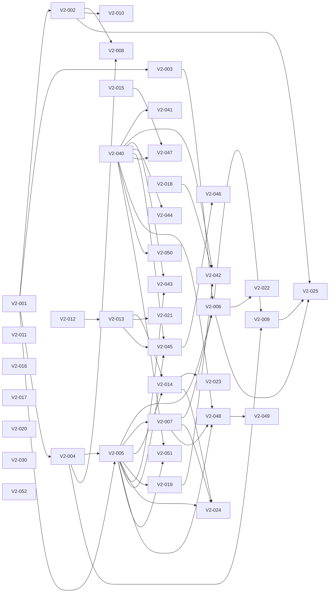

# Backlog fase 2 — Perfiles, tipos de encuesta, diseño y contenido

**Versión:** 2.0 · **Estado:** planificado, ninguna tarea iniciada · **Origen:** auditoría y respuestas del propietario del 28-10-2026 (decisiones D-015 a D-021).

> Este documento amplía el MVP con funciones que el [brief](brief-producto.md) dejaba fuera (§3.2, §5 y §8). El brief se conserva como fuente histórica; donde choque con este backlog, prevalecen las decisiones D-015 a D-021 de [decisiones.md](decisiones.md). El backlog del MVP ([backlog.md](backlog.md)) sigue vigente para sus tareas pendientes (MVP-005, MVP-049 a MVP-051).
>
> **El feed (épica E10) está por definir.** Ver [feed-por-definir.md](feed-por-definir.md). Sólo se puede reservar su tarea de definición, V2-030.
>
> **La épica E12 (crecimiento y hábito)** reúne propuestas de agente redactadas a petición de un miembro del equipo que no es el propietario. Son P1 y no entran en el alcance hasta que V2-040 obtenga su confirmación, salvo V2-052.

## 1. Cómo usar este documento

- Cada tarea tiene ID `V2-NNN`, prioridad, tamaño, dependencias, descripción, requisitos y criterios de aceptación. Quien la coja no necesita más contexto que este documento, [contratos-api.md](contratos-api.md) y el código que se cita.
- **Tamaños:** S ≈ 0,5 día, M ≈ 1 día, L ≈ 2 días. Si una L crece, dividirla sin cambiar sus criterios.
- **Prioridad:** `P0` es imprescindible para la fase 2; `P1` es una mejora que no bloquea.
- Se aplican sin cambios el [protocolo de reserva, ramas y PR](../AGENTS.md), TDD obligatorio (`npm test`, `npm run test:db`, `npm run test:e2e`; ver [README](../README.md)) y la skill `impeccable` para la interfaz.
- **Toda tabla y RPC nueva** nace sin permisos (migración `harden_default_privileges`): la migración debe hacer `GRANT` explícito, activar RLS y añadir su test SQL en `supabase/tests/`. Hay que ampliar `008_privileges.test.sql` con cada RPC nueva y regenerar `src/lib/supabase/database.types.ts`.
- **Funciones SQL compartidas:** una migración que redefine una función (`create or replace`) sustituye su cuerpo entero. Si dos PR la redefinen en paralelo, la última fusionada borra en silencio los cambios de la otra, porque al ser archivos distintos git no da conflicto. Por eso las tareas que tocan la misma función están encadenadas como dependencias. Además, partir siempre del cuerpo vigente en `main` y, justo antes de fusionar, comprobar que ninguna PR fusionada entretanto ha tocado esa función. Las comprobaciones nuevas al crear o votar van en triggers `BEFORE INSERT` para no reescribir `create_poll` ni `vote_poll`.
- Al terminar una tarea, actualizar [contratos-api.md](contratos-api.md) si cambia un contrato.

## 2. Reglas de producto fijadas (resumen de D-015 a D-021)

| Tema | Regla |
|---|---|
| Modelo de datos | Se permiten tablas nuevas además de `polls`, `poll_options` y `votes` (D-015). |
| Identidad | Cada cuenta tiene un perfil con `@usuario` único y nombre visible opcional. Las encuestas se firman con `@usuario` (D-016). |
| Privacidad de cuenta | Cada perfil es **público** (por defecto) o **privado** (D-016). |
| Relaciones | Seguidores tipo Instagram: seguir es unidireccional; seguir una cuenta privada crea una **solicitud** que el dueño acepta o rechaza. «Amigos» = seguidores aceptados (D-017). |
| Quién ve qué | Cuenta pública: todo el mundo, también sin sesión, ve su perfil, sus encuestas y sus votos. Cuenta privada: sólo el propio usuario y sus seguidores aceptados ven sus encuestas y sus votos. El resto ve sólo la cabecera del perfil (@usuario, nombre y contadores) (D-017, D-018). |
| Votos en el perfil | Se muestran la encuesta y **la opción elegida** a quien pueda ver el perfil (D-018). Ver la pregunta abierta P-1. |
| Tipos de encuesta | Plantilla Sí/No; entre 2 y **6** opciones (D-019). |
| Cierre | Fecha de cierre opcional. Cerrada, no admite votos y **sus resultados pasan a ser visibles para todos** los que puedan ver la encuesta, aunque no hayan votado (D-020). |
| Regla crítica | Sigue vigente para toda encuesta **abierta**: nadie, ni el autor, obtiene agregados antes de votar. La única excepción es la encuesta cerrada (D-020). Siempre se impone en Supabase. |
| Contenido | Denuncias, categorías fijas y «Guardar para luego» (D-021). |
| Crecimiento (E12) | Propuestas de agente, no decisiones D-015 a D-021 ni del propietario. Bloqueadas hasta que V2-040 obtenga su confirmación (salvo V2-052). Las que cambian una regla o dependen de un servicio externo necesitan además una decisión concreta. |

### Supuestos tomados por el planificador (corregibles por el propietario)

- **S-1 `@usuario`:** obligatorio. Se elige tras el primer login y hace falta tenerlo para crear, votar o seguir; explorar no lo requiere. Formato: 3–20 caracteres `[a-z0-9_]`, empieza por letra, único sin distinguir mayúsculas, con lista de nombres reservados. Se puede cambiar; los enlaces antiguos dejan de funcionar.
- **S-2 Nombre visible:** opcional, de 1 a 50 caracteres. No se usa el nombre de Google por defecto, para no publicar datos personales sin que el usuario lo decida.
- **S-3 Avatar:** iniciales sobre un color derivado del `@usuario`. No hay subida de imágenes ni foto de Google.
- **S-4 Contadores:** seguidores, seguidos y encuestas creadas son visibles también en cuentas privadas, como en Instagram.
- **S-5 Encuestas existentes:** se atribuyen al `@usuario` de su autor cuando lo elija. Mientras no lo tenga, aparecen como «Anónimo».
- **S-6 Cambio de privacidad:** pasar de pública a privada oculta de inmediato sus encuestas y votos a quien no sea seguidor aceptado. Pasar de privada a pública acepta todas las solicitudes pendientes.
- **S-7 Votar en encuestas de cuentas privadas:** sólo pueden votarlas quienes pueden verlas.
- **S-8 Denuncias:** no ocultan nada automáticamente; las revisa un moderador con el procedimiento de [moderacion.md](moderacion.md).
- **S-9 Guardadas:** la lista de guardadas es privada siempre; sólo la ve su dueño.
- **S-10 Pregunta del día (E12):** la elige una persona con acceso SQL, igual que la moderación. No hay selección automática ni panel.
- **S-11 Día y racha (E12):** el día natural se calcula en `Europe/Madrid`. Un día cuenta si la cuenta tiene al menos un voto, y la racha no se rompe hasta que pasa un día entero sin votar.
- **S-12 Predicciones (E12):** sólo se predice qué opción ganará, antes de votar, una vez por encuesta y sin cambios. Acierta si su opción tiene en ese momento el máximo de votos (los empates cuentan). No hay marcador acumulado en esta fase.
- **S-13 Medición (E12):** consultas de agregados que ejecuta un operador, sin tabla de eventos ni analítica de terceros y sin identificar a nadie. Las visitas a enlaces no se miden.

### Preguntas abiertas

- **P-1 Votos públicos frente a la regla crítica.** Si en un perfil se ve la opción elegida en encuestas que el visitante todavía no ha votado, recorriendo perfiles se puede intuir qué opción va ganando antes de votar. **Propuesta:** en el perfil ajeno, mostrar la opción elegida sólo en encuestas que el visitante ya ha votado o que están cerradas; en el resto, «Votó · vota para ver su elección». V2-007 implementa la propuesta salvo que el propietario indique lo contrario.

- **P-2 Imagen «Mi voto» y la regla crítica (V2-042).** La imagen se genera para quien ya votó y la puede reenviar a quien no. Mostrar en ella el porcentaje de su opción enseñaría un agregado de una encuesta abierta a gente que no ha votado. **Por defecto** V2-042 no incluye ninguna cifra mientras la encuesta esté abierta. Cambiarlo requiere decisión del propietario.
- **P-3 Retos de compatibilidad (V2-048).** Comparar a dos personas revela algo de ambas. Opciones: (a) sólo el número de coincidencias, sin nombres (propuesta); (b) con `@usuario` y detalle por encuesta, sólo entre cuentas que lo aceptan; (c) no hacerlo. Riesgo de (a): con varias cuentas de prueba se puede deducir qué votó quien lanzó el reto. El límite diario por cuenta y exigir haber votado antes lo reducen, no lo eliminan.
- **P-4 Sugerencias con IA (V2-050).** El brief (§4) excluye servicios externos. Decidir si se acepta un proveedor de modelos, cuál, quién asume el coste, qué se le envía (sólo el tema que escribe la persona) y el límite de uso por cuenta.
- **P-5 Encuesta incrustable (V2-051).** Permitir que otras webs incrusten una página de Opinión abre la puerta al clickjacking y exige cambiar cabeceras de seguridad, que gestiona Codex /root con la configuración de Vercel. Decidir si se acepta y para qué rutas.
- **P-6 Voto automático tras el login (sin tarea).** V2-052 conserva la elección y exige un toque de confirmación, como fija la regla actual. Votar solo al volver del login subiría la conversión, pero cambia esa regla y aún no hay datos que lo justifiquen. Sólo se plantearía con las métricas de V2-041 delante.

## 3. Catálogo

| ID | Título | Prioridad | Tamaño | Etiquetas | Dependencias |
|---|---|---|---|---|---|
| **E06 — Perfiles y relaciones** | | | | | |
| V2-001 | Crear tabla `profiles` y RPC de perfil | P0 | L | `database`, `security` | — |
| V2-002 | Onboarding: elegir `@usuario` tras el primer login | P0 | M | `frontend`, `auth` | V2-001 |
| V2-003 | Firmar encuestas con `@usuario` | P0 | M | `backend`, `frontend` | V2-001 |
| V2-004 | Crear tabla `follows` con solicitudes | P0 | L | `database`, `security` | V2-001 |
| V2-005 | Visibilidad de cuentas privadas en RLS y RPC | P0 | L | `database`, `security` | V2-001, V2-004 |
| V2-006 | Página de perfil `/u/[username]` | P0 | L | `frontend` | V2-003, V2-005, V2-007 |
| V2-007 | RPC de votos visibles en un perfil | P0 | M | `database`, `security` | V2-005 |
| V2-008 | Ajustes de perfil y privacidad (`/settings`) | P0 | M | `frontend` | V2-002, V2-004 |
| V2-009 | Seguidores, seguidos y solicitudes | P0 | M | `frontend` | V2-004, V2-006 |
| V2-010 | Navegación con perfil: cabecera y barra inferior móvil | P1 | M | `frontend`, `design` | V2-002 |
| **E07 — Tipos de encuesta** | | | | | |
| V2-011 | Plantilla Sí/No en el formulario | P1 | S | `frontend` | — |
| V2-012 | Permitir hasta 6 opciones | P0 | M | `database`, `frontend` | — |
| V2-013 | Fecha de cierre opcional | P0 | L | `database`, `frontend` | V2-012 |
| V2-014 | Resultados públicos al cerrarse | P0 | L | `database`, `security`, `frontend` | V2-005, V2-013 |
| **E08 — Diseño y experiencia** | | | | | |
| V2-015 | Animar las barras al revelar resultados | P1 | S | `frontend`, `design` | — |
| V2-016 | Mensaje «Coincides con el X %» tras votar | P1 | S | `frontend` | — |
| V2-017 | Modo oscuro | P1 | M | `frontend`, `design` | — |
| V2-018 | Compartir con la hoja nativa | P1 | S | `frontend` | — |
| V2-019 | Imagen OG dinámica por encuesta | P1 | M | `frontend` | V2-005 |
| **E09 — Contenido y seguridad** | | | | | |
| V2-020 | Denunciar una encuesta | P0 | M | `database`, `frontend`, `security` | — |
| V2-021 | Categorías fijas al crear y en la tarjeta | P1 | M | `database`, `frontend` | V2-013 |
| V2-022 | Guardar para luego | P1 | M | `database`, `frontend` | V2-006 |
| **E10 — Feed (en discusión)** | | | | | |
| V2-030 | Definir el feed con el propietario | P0 | M | `product`, `docs` | — |
| V2-031… | Tareas del feed, por crear al terminar V2-030 | — | — | `frontend`, `backend` | V2-030 |
| **E11 — Calidad y rendimiento** | | | | | |
| V2-023 | RPC de resultados por lotes para el feed | P1 | M | `database`, `backend` | V2-014 |
| V2-024 | Pruebas de fugas de privacidad y cierre | P0 | M | `testing`, `security` | V2-005, V2-007, V2-014 |
| V2-025 | E2E del ciclo social | P0 | M | `testing` | V2-002, V2-006, V2-009 |
| **E12 — Crecimiento y hábito** | | | | | |
| V2-040 | Decidir con el propietario las apuestas de crecimiento | P1 | S | `product`, `docs` | — |
| V2-041 | Métricas del ciclo desde SQL | P1 | M | `database`, `testing` | V2-040 |
| V2-042 | Imagen «Mi voto» para compartir | P1 | M | `frontend`, `backend` | V2-018, V2-019, V2-040 |
| V2-043 | Pregunta del día y ruta `/hoy` | P1 | M | `database`, `frontend` | V2-005, V2-040 |
| V2-044 | Racha de participación | P1 | S | `database`, `frontend` | V2-040 |
| V2-045 | Predicciones: tabla y RPC | P1 | M | `database`, `security` | V2-005, V2-013, V2-040 |
| V2-046 | Predicciones: interfaz | P1 | M | `frontend` | V2-045 |
| V2-047 | Vibración y texto en la revelación | P1 | S | `frontend`, `design` | V2-015, V2-040 |
| V2-048 | Retos de compatibilidad: modelo y RPC | P1 | L | `database`, `security` | V2-005, V2-007, V2-040 |
| V2-049 | Retos de compatibilidad: interfaz | P1 | M | `frontend` | V2-048 |
| V2-050 | Sugerir una pregunta con IA | P1 | M | `backend`, `frontend`, `security` | V2-040 |
| V2-051 | Encuesta incrustable | P1 | M | `frontend`, `security` | V2-005, V2-040 |
| V2-052 | Conservar la elección al iniciar sesión | P1 | S | `frontend`, `auth` | — |

Qué bloquea a qué y por cuál empezar: ver la sección 4, «Mapa de dependencias».

## 4. Mapa de dependencias

**Cómo leerlo.** «Depende de» son las tareas que tienen que estar **Completadas** (fusionadas y verificadas) antes de empezar. «Bloquea a» son las que esperan a esta. Una tarea está disponible cuando todas sus dependencias están completadas y nadie la tiene reservada en `tareas-futuras.md` de `main`.

| Tarea | Prioridad | Tamaño | Depende de | Bloquea a | Oleada |
|---|---|---|---|---|---|
| [V2-001](https://github.com/migdlp/opinion-social-media/issues/115) Crear tabla `profiles` y RPC de perfil | P0 | L | — | V2-002, V2-003, V2-004, V2-005 | 0 |
| [V2-002](https://github.com/migdlp/opinion-social-media/issues/124) Onboarding: elegir `@usuario` tras el primer login | P0 | M | V2-001 | V2-008, V2-010, V2-025 | 1 |
| [V2-003](https://github.com/migdlp/opinion-social-media/issues/125) Firmar encuestas con `@usuario` | P0 | M | V2-001 | V2-006 | 1 |
| [V2-004](https://github.com/migdlp/opinion-social-media/issues/126) Crear tabla `follows` con solicitudes | P0 | L | V2-001 | V2-005, V2-008, V2-009 | 1 |
| [V2-005](https://github.com/migdlp/opinion-social-media/issues/128) Visibilidad de cuentas privadas en RLS y RPC | P0 | L | V2-001, V2-004 | V2-006, V2-007, V2-014, V2-019, V2-024, V2-043, V2-045, V2-048, V2-051 | 2 |
| [V2-006](https://github.com/migdlp/opinion-social-media/issues/135) Página de perfil `/u/[username]` | P0 | L | V2-003, V2-005, V2-007 | V2-009, V2-022, V2-025 | 4 |
| [V2-007](https://github.com/migdlp/opinion-social-media/issues/132) RPC de votos visibles en un perfil | P0 | M | V2-005 | V2-006, V2-024, V2-048 | 3 |
| [V2-008](https://github.com/migdlp/opinion-social-media/issues/129) Ajustes de perfil y privacidad (`/settings`) | P0 | M | V2-002, V2-004 | — | 2 |
| [V2-009](https://github.com/migdlp/opinion-social-media/issues/138) Seguidores, seguidos y solicitudes | P0 | M | V2-004, V2-006 | V2-025 | 5 |
| [V2-010](https://github.com/migdlp/opinion-social-media/issues/130) Navegación con perfil: cabecera y barra inferior móvil | P1 | M | V2-002 | — | 2 |
| [V2-011](https://github.com/migdlp/opinion-social-media/issues/116) Plantilla Sí/No en el formulario | P1 | S | — | — | 0 |
| [V2-012](https://github.com/migdlp/opinion-social-media/issues/117) Permitir hasta 6 opciones | P0 | M | — | V2-013 | 0 |
| [V2-013](https://github.com/migdlp/opinion-social-media/issues/127) Fecha de cierre opcional | P0 | L | V2-012 | V2-014, V2-021, V2-045 | 1 |
| [V2-014](https://github.com/migdlp/opinion-social-media/issues/133) Resultados públicos al cerrarse | P0 | L | V2-005, V2-013 | V2-023, V2-024 | 3 |
| [V2-015](https://github.com/migdlp/opinion-social-media/issues/118) Animar las barras al revelar resultados | P1 | S | — | V2-047 | 0 |
| [V2-016](https://github.com/migdlp/opinion-social-media/issues/119) Mensaje «Coincides con el X %» tras votar | P1 | S | — | — | 0 |
| [V2-017](https://github.com/migdlp/opinion-social-media/issues/120) Modo oscuro | P1 | M | — | — | 0 |
| [V2-018](https://github.com/migdlp/opinion-social-media/issues/121) Compartir con la hoja nativa | P1 | S | — | V2-042 | 0 |
| [V2-019](https://github.com/migdlp/opinion-social-media/issues/134) Imagen OG dinámica por encuesta | P1 | M | V2-005 | V2-042 | 3 |
| [V2-020](https://github.com/migdlp/opinion-social-media/issues/122) Denunciar una encuesta | P0 | M | — | — | 0 |
| [V2-021](https://github.com/migdlp/opinion-social-media/issues/131) Categorías fijas al crear y en la tarjeta | P1 | M | V2-013 | — | 2 |
| [V2-022](https://github.com/migdlp/opinion-social-media/issues/139) Guardar para luego | P1 | M | V2-006 | — | 5 |
| [V2-023](https://github.com/migdlp/opinion-social-media/issues/136) RPC de resultados por lotes para el feed | P1 | M | V2-014 | — | 4 |
| [V2-024](https://github.com/migdlp/opinion-social-media/issues/137) Pruebas de fugas de privacidad y cierre | P0 | M | V2-005, V2-007, V2-014 | — | 4 |
| [V2-025](https://github.com/migdlp/opinion-social-media/issues/140) E2E del ciclo social | P0 | M | V2-002, V2-006, V2-009 | — | 6 |
| [V2-030](https://github.com/migdlp/opinion-social-media/issues/123) Definir el feed con el propietario | P0 | M | — | — | 0 |
| [V2-040](https://github.com/migdlp/opinion-social-media/issues/170) Decidir con el propietario las apuestas de crecimiento | P1 | S | — | V2-041, V2-042, V2-043, V2-044, V2-045, V2-047, V2-048, V2-050, V2-051 | 0 |
| [V2-041](https://github.com/migdlp/opinion-social-media/issues/163) Métricas del ciclo desde SQL | P1 | M | V2-040 | — | 1 |
| [V2-042](https://github.com/migdlp/opinion-social-media/issues/164) Imagen «Mi voto» para compartir | P1 | M | V2-018, V2-019, V2-040 | — | 4 |
| [V2-043](https://github.com/migdlp/opinion-social-media/issues/165) Pregunta del día y ruta `/hoy` | P1 | M | V2-005, V2-040 | — | 3 |
| [V2-044](https://github.com/migdlp/opinion-social-media/issues/166) Racha de participación | P1 | S | V2-040 | — | 1 |
| [V2-045](https://github.com/migdlp/opinion-social-media/issues/167) Predicciones: tabla y RPC | P1 | M | V2-005, V2-013, V2-040 | V2-046 | 3 |
| [V2-046](https://github.com/migdlp/opinion-social-media/issues/172) Predicciones: interfaz | P1 | M | V2-045 | — | 4 |
| [V2-047](https://github.com/migdlp/opinion-social-media/issues/168) Vibración y texto en la revelación | P1 | S | V2-015, V2-040 | — | 1 |
| [V2-048](https://github.com/migdlp/opinion-social-media/issues/173) Retos de compatibilidad: modelo y RPC | P1 | L | V2-005, V2-007, V2-040 | V2-049 | 4 |
| [V2-049](https://github.com/migdlp/opinion-social-media/issues/176) Retos de compatibilidad: interfaz | P1 | M | V2-048 | — | 5 |
| [V2-050](https://github.com/migdlp/opinion-social-media/issues/174) Sugerir una pregunta con IA | P1 | M | V2-040 | — | 1 |
| [V2-051](https://github.com/migdlp/opinion-social-media/issues/175) Encuesta incrustable | P1 | M | V2-005, V2-040 | — | 3 |
| [V2-052](https://github.com/migdlp/opinion-social-media/issues/169) Conservar la elección al iniciar sesión | P1 | S | — | — | 0 |

### Oleadas

Todas las tareas de una oleada pueden hacerse en paralelo cuando la anterior está terminada (en realidad basta con que lo estén sus propias dependencias).

- **Oleada 0:** V2-001 (P0), V2-011 (P1), V2-012 (P0), V2-015 (P1), V2-016 (P1), V2-017 (P1), V2-018 (P1), V2-020 (P0), V2-030 (P0), V2-040 (P1), V2-052 (P1)
- **Oleada 1:** V2-002 (P0), V2-003 (P0), V2-004 (P0), V2-013 (P0), V2-041 (P1), V2-044 (P1), V2-047 (P1), V2-050 (P1)
- **Oleada 2:** V2-005 (P0), V2-008 (P0), V2-010 (P1), V2-021 (P1)
- **Oleada 3:** V2-007 (P0), V2-014 (P0), V2-019 (P1), V2-043 (P1), V2-045 (P1), V2-051 (P1)
- **Oleada 4:** V2-006 (P0), V2-023 (P1), V2-024 (P0), V2-042 (P1), V2-046 (P1), V2-048 (P1)
- **Oleada 5:** V2-009 (P0), V2-022 (P1), V2-049 (P1)
- **Oleada 6:** V2-025 (P0)

### Camino crítico

La cadena más larga, unos 11 días de trabajo secuencial, es **V2-001 → V2-004 → V2-005 → V2-007 → V2-006 → V2-009 → V2-025**. Retrasar cualquiera de ellas retrasa el final de la fase. Si hay varios agentes, conviene que uno se dedique a esta cadena.

### Con cuál empezar

1. **Primero el camino crítico:** si V2-001 está libre, cogerla; después seguir la cadena (V2-004 → V2-005 → V2-007 → V2-006 → V2-009 → V2-025).
2. **Segundo agente, cadena de encuestas:** V2-012 → V2-013 → V2-014 (cuando V2-005 esté completada) → V2-021 / V2-023.
3. **Tercer agente, interfaz sin dependencias:** V2-011, V2-015, V2-016, V2-017, V2-018 y V2-020 no bloquean ni dependen de nada. Son buenas para huecos o para alguien que empieza.
4. **Producto:** V2-030 (definir el feed) no requiere código y puede ir en paralelo con todo.
5. Entre varias disponibles, P0 antes que P1, y la que más tareas bloquee antes que la que no bloquea ninguna.
6. **Épica E12 (todas P1, después de las P0 disponibles):** sólo V2-052 está disponible sin confirmación. V2-040 no requiere código, pero necesita respuestas del propietario y bloquea al resto de la épica. V2-045 → V2-046 y V2-048 → V2-049 son cadenas.

### Grafo

## 5. Detalle de tareas

### E06 — Perfiles y relaciones

#### V2-001 — Crear tabla `profiles` y RPC de perfil

- **Prioridad:** P0 · **Tamaño:** L · **Dependencias:** — · **Bloquea a:** V2-002, V2-003, V2-004, V2-005
- **Descripción:** Tabla de perfil 1:1 con `auth.users` y funciones para crear y editar el propio perfil. Es la base de toda la épica.
- **Requisitos:**
  - Tabla `public.profiles`: `user_id uuid PK references auth.users on delete cascade`, `username text not null`, `display_name text null`, `is_private boolean not null default false`, `created_at timestamptz not null default now()`, `updated_at timestamptz not null default now()`.
  - `username`: `CHECK (username ~ '^[a-z][a-z0-9_]{2,19}$')` e índice único sobre `lower(username)`. `display_name`: entre 1 y 50 caracteres tras normalizar, o nulo.
  - Nombres reservados (rechazados con `USERNAME_RESERVED`): `admin`, `me`, `settings`, `login`, `logout`, `create`, `polls`, `u`, `api`, `auth`, `onboarding`, `opinion`, `soporte`, `support`, `moderacion`. Guardarlos en la propia función, no en una tabla.
  - RPC `upsert_my_profile(p_username text, p_display_name text)` → fila del perfil. Errores nuevos: `USERNAME_INVALID`, `USERNAME_TAKEN`, `USERNAME_RESERVED`, `DISPLAY_NAME_INVALID`. Normaliza el `username` a minúsculas.
  - RPC `set_profile_privacy(p_private boolean)`. Al pasar a pública, acepta las solicitudes pendientes (cuando exista V2-004, dejar el hueco documentado).
  - RLS: `select` de `username`, `display_name`, `is_private` y `created_at` para `anon` y `authenticated`. Sin escrituras directas. `user_id` sólo se concede si hace falta para joins internos de RPC, nunca a clientes.
  - Añadir los códigos nuevos a `src/lib/data/errors.ts` con mensajes en español y a `contratos-api.md` §2.
- **Criterios de aceptación:**
  1. Dado un usuario sin perfil, cuando llama a `upsert_my_profile('ana_23', null)`, entonces se crea su perfil con `username = 'ana_23'`.
  2. Dado `ana_23` ya en uso, cuando otro usuario pide `ANA_23`, entonces recibe `USERNAME_TAKEN`.
  3. Dado `p_username` `'1ana'`, `'an'`, `'admin'` o con espacios, entonces se rechaza con el código correspondiente y no se escribe nada.
  4. Dado `anon`, cuando intenta `insert`/`update`/`delete` en `profiles` o ejecutar las RPC, entonces se deniega.
  5. Dado cualquier cliente, cuando lee `profiles`, entonces no obtiene `user_id` ni email.

#### V2-002 — Onboarding: elegir `@usuario` tras el primer login

- **Prioridad:** P0 · **Tamaño:** M · **Dependencias:** V2-001 · **Bloquea a:** V2-008, V2-010, V2-025
- **Descripción:** Página `/onboarding` donde el usuario elige `@usuario` y, opcionalmente, nombre visible. Es obligatoria antes de crear, votar o seguir (S-1).
- **Requisitos:**
  - El callback de OAuth (`src/app/auth/callback/route.ts`) redirige a `/onboarding?next=<ruta>` si el usuario no tiene perfil, conservando `next` con la validación de `src/lib/auth/redirect.ts`.
  - Las server actions de crear y votar (y las de seguir de V2-004) devuelven un código `PROFILE_REQUIRED` si falta el perfil. La interfaz lo convierte en un enlace a `/onboarding?next=…`. Imponerlo también en la base de datos con triggers `BEFORE INSERT` en `polls` y `votes` que lancen `PROFILE_REQUIRED` (así no se reescriben `create_poll` ni `vote_poll`, que tocan otras tareas).
  - El formulario valida en cliente con las mismas reglas que V2-001 (nuevo `src/lib/validation/profile.ts`) y muestra en vivo `@usuario` y sus errores. Comprueba la disponibilidad al enviar, no en cada tecla.
  - Mobile-first, accesible y con los mismos estados que el resto (carga, error de red, nombre ocupado).
- **Criterios de aceptación:**
  1. Dado un usuario nuevo, cuando completa el login con Google, entonces llega a `/onboarding` y, tras guardar, vuelve a la ruta de la que venía.
  2. Dado un usuario sin perfil, cuando intenta votar o crear, entonces se le envía al onboarding y no se registra el voto ni la encuesta. La RPC lo rechaza aunque se llame directamente.
  3. Dado un usuario con perfil, cuando visita `/onboarding`, entonces se le redirige a `/`.
  4. Dado `@usuario` ocupado, cuando envía, entonces ve «Ese nombre ya está en uso» sin perder lo escrito.

#### V2-003 — Firmar encuestas con `@usuario`

- **Prioridad:** P0 · **Tamaño:** M · **Dependencias:** V2-001 · **Bloquea a:** V2-006
- **Descripción:** Sustituir «Anónimo» por `@usuario` enlazado a `/u/[username]` en la tarjeta y el detalle.
- **Requisitos:**
  - Exponer el autor sin dar `polls.user_id` a los clientes. Opción recomendada: vista `public.polls_with_author` (`security_invoker = true`) o una columna calculada vía RPC que devuelva `author_username` y `author_display_name`. Documentar la elegida en `contratos-api.md` §4.
  - Ampliar `PublicPoll` en `src/lib/data/types.ts` con `author: { username: string; displayName: string | null } | null` (`null` = sin perfil, que se muestra como «Anónimo», S-5).
  - Actualizar `getFeedPolls` y `getPublicPoll` (`src/lib/data/polls.ts`), `PollCard` y `PollDetailView`.
- **Criterios de aceptación:**
  1. Dado una encuesta de `@ana_23`, cuando se ve en el feed o en el detalle, entonces muestra `@ana_23` (y su nombre visible si lo tiene) con enlace a `/u/ana_23`.
  2. Dado un autor sin perfil, entonces se muestra «Anónimo» sin enlace.
  3. Dado cualquier respuesta de feed o detalle, entonces no contiene `user_id` (cubrir con test de HTML SSR como `src/app/ssr-sin-fugas.test.tsx`).

#### V2-004 — Crear tabla `follows` con solicitudes

- **Prioridad:** P0 · **Tamaño:** L · **Dependencias:** V2-001 · **Bloquea a:** V2-005, V2-008, V2-009
- **Descripción:** Relación de seguimiento unidireccional con aprobación para cuentas privadas (D-017).
- **Requisitos:**
  - Tabla `public.follows`: `follower_id uuid`, `followee_id uuid` (ambos referencian `auth.users` con `on delete cascade`), `status text check (status in ('pending','accepted'))`, `created_at`, `PRIMARY KEY (follower_id, followee_id)` y `CHECK (follower_id <> followee_id)`. Índices por `followee_id, status` y `follower_id, status`.
  - RPC, todas por `username` y nunca por `user_id` en la interfaz pública:
    - `follow_user(p_username)` → `'accepted'` si la cuenta es pública, `'pending'` si es privada. Idempotente.
    - `unfollow_user(p_username)` también cancela una solicitud pendiente.
    - `respond_follow_request(p_username, p_accept boolean)`: aceptar la convierte en `accepted`; rechazar la borra.
    - `remove_follower(p_username)`.
    - Completar en `set_profile_privacy(false)` la aceptación de las pendientes (S-6).
  - Límite anti-abuso: como máximo 200 `follow_user` por hora y cuenta (código nuevo `FOLLOW_RATE_LIMITED`; `RATE_LIMITED` tiene un mensaje específico de encuestas).
  - RLS: cada usuario lee las filas donde es `follower_id` o `followee_id`. Los contadores públicos se obtienen por RPC (V2-006), no por lectura directa.
  - Códigos nuevos: `USER_NOT_FOUND`, `CANNOT_FOLLOW_SELF`.
- **Criterios de aceptación:**
  1. Dado `@b` público, cuando `@a` lo sigue, entonces la fila queda `accepted`.
  2. Dado `@b` privado, cuando `@a` lo sigue, entonces queda `pending` y `@b` puede aceptarla o rechazarla. Sólo `@b` puede hacerlo.
  3. Dado que `@a` se intenta seguir a sí mismo, entonces recibe `CANNOT_FOLLOW_SELF`.
  4. Dado `@b` privado con solicitudes pendientes, cuando pasa a público, entonces todas quedan `accepted`.
  5. Dado un tercero `@c`, cuando consulta `follows`, entonces no ve relaciones entre `@a` y `@b`.

#### V2-005 — Visibilidad de cuentas privadas en RLS y RPC

- **Prioridad:** P0 · **Tamaño:** L · **Dependencias:** V2-001, V2-004 · **Bloquea a:** V2-006, V2-007, V2-014, V2-019, V2-024
- **Descripción:** Imponer en la base de datos que las encuestas de una cuenta privada sólo las vean su autor y sus seguidores aceptados (D-017). Es la tarea de seguridad más delicada de la fase.
- **Requisitos:**
  - Función `public.can_view_author(p_author uuid) returns boolean` (`stable`, `security definer`, `search_path = ''`): verdadera si el autor no tiene perfil o lo tiene público, si `auth.uid() = p_author` o si existe un `follows` aceptado de `auth.uid()` hacia `p_author`. Sin `EXECUTE` para clientes si no lo necesitan.
  - Sustituir la política `polls_select_published` por `status = 'published' AND can_view_author(user_id)`. `poll_options` ya hereda la visibilidad por su subconsulta: verificarlo con un test.
  - Votar: trigger `BEFORE INSERT` en `votes` que lance `POLL_UNAVAILABLE` si `can_view_author` es falsa (S-7), sin reescribir `vote_poll`. Resultados: añadir la misma comprobación en `get_poll_results`. Así, una encuesta privada es indistinguible de una inexistente.
  - Los metadatos de `/polls/[id]` (`src/app/polls/[id]/metadata.ts`) y la futura imagen OG no deben revelar la pregunta de una encuesta privada a quien no pueda verla.
  - Medir el plan de consulta del feed con `explain analyze` en dev con datos de prueba (≥ 1.000 encuestas y 50 relaciones) y añadir índices si hace falta. Registrar el resultado en la PR.
- **Criterios de aceptación:**
  1. Dado `@b` privado con una encuesta, cuando la piden `anon` o `@c` (que no lo sigue), entonces no aparece en el feed y `/polls/[id]` responde 404.
  2. Dado `@a` seguidor aceptado de `@b`, entonces la ve en el feed y en el detalle y puede votarla.
  3. Dado `@a` con solicitud pendiente, entonces no la ve.
  4. Dado `@c` que conoce el UUID, cuando llama a `vote_poll` o `get_poll_results` directamente, entonces recibe `POLL_UNAVAILABLE`.
  5. Dado que `@b` pasa de pública a privada, cuando `@c` recarga, entonces sus encuestas desaparecen.

#### V2-006 — Página de perfil `/u/[username]`

- **Prioridad:** P0 · **Tamaño:** L · **Dependencias:** V2-003, V2-005, V2-007 · **Bloquea a:** V2-009, V2-022, V2-025
- **Descripción:** Perfil con cabecera, botón de seguir y pestañas «Creadas» y «Votadas».
- **Requisitos:**
  - RPC `get_profile(p_username)` → `username`, `display_name`, `is_private`, `followers_count`, `following_count`, `polls_count`, `viewer_relation` (`'self' | 'none' | 'pending' | 'following'`) y `can_view_content boolean`. `USER_NOT_FOUND` → 404.
  - Cabecera: avatar de iniciales (S-3), nombre visible, `@usuario`, contadores (enlazan a V2-009) y botón según `viewer_relation`: Seguir / Solicitado (cancela) / Siguiendo (deja de seguir, con confirmación) / Editar perfil (propio).
  - Pestaña «Creadas»: encuestas del autor con `PollCard` y paginación por cursor como el feed (reutilizar `FeedList`).
  - Pestaña «Votadas»: usa V2-007 y muestra la opción elegida según P-1.
  - Pestaña «Guardadas» sólo en el perfil propio (cuando exista V2-022).
  - Cuenta privada sin acceso: cabecera y el mensaje «Esta cuenta es privada. Síguela para ver sus encuestas y votos».
  - La pestaña activa va en la URL (`?tab=votadas`) para poder compartirla. `/me` redirige a `/u/<propio>` o a `/onboarding`.
  - Renderizado dinámico y sin caché compartida (D-014, `cacheComponents`).
- **Criterios de aceptación:**
  1. Dado `@b` público, cuando lo abre un visitante sin sesión, entonces ve cabecera, Creadas y Votadas. El botón Seguir lleva al login.
  2. Dado `@b` privado y un visitante no seguidor, entonces sólo ve la cabecera y el aviso, y el HTML no contiene encuestas ni votos de `@b`.
  3. Dado `@a`, cuando pulsa Seguir en `@b` privado, entonces el botón pasa a «Solicitado» sin recargar.
  4. Dado un `username` inexistente, entonces responde 404.
  5. Funciona a 320 px sin scroll horizontal y con teclado.

#### V2-007 — RPC de votos visibles en un perfil

- **Prioridad:** P0 · **Tamaño:** M · **Dependencias:** V2-005 · **Bloquea a:** V2-006, V2-024
- **Descripción:** Listar las encuestas votadas por un usuario y su opción, respetando su privacidad y P-1.
- **Requisitos:**
  - RPC `get_profile_votes(p_username, p_cursor)` (`security definer`), páginas de 20 por `votes.created_at DESC, votes.id DESC`.
  - Devuelve sólo las encuestas que el visitante puede ver (`can_view_author` del autor de cada encuesta) y sólo si puede ver el perfil del votante (`self`, cuenta pública o seguidor aceptado). Si no, `PROFILE_PRIVATE`.
  - Por cada fila: datos públicos de la encuesta y del autor, `voted_at` y `option_id`. Según P-1, `option_id` sólo viene relleno si el visitante es el propio usuario, si ya votó esa encuesta o si está cerrada (V2-014). En otro caso llega `null` con `choice_hidden = true`.
  - Nunca devuelve recuentos ni porcentajes: los resultados se piden aparte con `get_poll_results`, que mantiene la regla crítica.
- **Criterios de aceptación:**
  1. Dado `@b` público que votó la opción X en la encuesta P, y `@a` que también votó P, cuando `@a` consulta, entonces ve P con la opción X.
  2. Dado `@a` que no votó P (abierta), entonces ve P con `choice_hidden = true` y sin `option_id`.
  3. Dado `@b` privado y `@c` no seguidor, entonces recibe `PROFILE_PRIVATE`.
  4. Dado que P es de una cuenta privada que el visitante no puede ver, entonces P no aparece aunque `@b` sea público.
  5. Ninguna respuesta incluye agregados.

#### V2-008 — Ajustes de perfil y privacidad (`/settings`)

- **Prioridad:** P0 · **Tamaño:** M · **Dependencias:** V2-002, V2-004 · **Bloquea a:** —
- **Descripción:** Página para cambiar el nombre visible, el `@usuario` y la privacidad.
- **Requisitos:**
  - Reutiliza la validación de V2-002 y llama a `upsert_my_profile` y `set_profile_privacy`.
  - Interruptor «Cuenta privada» con una explicación clara. Al activarlo, confirmar: «Tus encuestas y votos sólo los verán tus seguidores. Las personas que ya te siguen seguirán haciéndolo».
  - Al cambiar `@usuario`, avisar de que los enlaces antiguos dejarán de funcionar (S-1).
  - Requiere sesión; sin ella, lleva a `/login?next=/settings`.
- **Criterios de aceptación:**
  1. Dado un usuario, cuando cambia a privada y confirma, entonces `is_private = true` y su perfil se comporta como en V2-006 (criterio 2).
  2. Dado un cambio de `@usuario` a uno ocupado, entonces se muestra el error y no cambia nada.
  3. Dado privada → pública, entonces las solicitudes pendientes quedan aceptadas.

#### V2-009 — Seguidores, seguidos y solicitudes

- **Prioridad:** P0 · **Tamaño:** M · **Dependencias:** V2-004, V2-006 · **Bloquea a:** V2-025
- **Descripción:** Listas de seguidores y seguidos, y bandeja de solicitudes.
- **Requisitos:**
  - Rutas `/u/[username]/seguidores` y `/u/[username]/siguiendo`, visibles con las mismas reglas que el contenido del perfil. RPC `list_followers(p_username, p_cursor)` y `list_following(p_username, p_cursor)` con páginas de 30.
  - `/solicitudes` (sólo propio): solicitudes pendientes con Aceptar / Rechazar. Indicador con el número de pendientes en la cabecera o en la barra inferior (V2-010).
  - En la lista de seguidores propia, acción «Eliminar» (`remove_follower`).
- **Criterios de aceptación:**
  1. Dado `@b` privado y `@c` no seguidor, cuando abre sus listas, entonces ve el aviso de cuenta privada.
  2. Dado `@b` con 2 solicitudes, cuando acepta una y rechaza otra, entonces la lista se actualiza y los contadores cambian.
  3. Las listas paginan sin duplicados.

#### V2-010 — Navegación con perfil: cabecera y barra inferior móvil

- **Prioridad:** P1 · **Tamaño:** M · **Dependencias:** V2-002 · **Bloquea a:** —
- **Descripción:** Acceso al perfil propio desde la cabecera y barra de navegación inferior en móvil.
- **Requisitos:**
  - Escritorio: el `AuthButton` (`src/components/auth-button.tsx`) muestra el avatar con un menú (Mi perfil, Ajustes, Solicitudes, Cerrar sesión).
  - Móvil (< 640 px): barra fija inferior Feed · Crear · Perfil con iconos y texto, `aria-current` en la activa y respeto de `safe-area-inset-bottom`. Sin sesión, «Perfil» lleva al login.
  - Seguir `DESIGN.md` y la skill `impeccable`.
- **Criterios de aceptación:**
  1. Dado móvil con sesión, entonces la barra inferior lleva a `/`, `/create` y `/me`, y marca la ruta actual.
  2. Navegable con teclado y con lector de pantalla (nombres accesibles).
  3. No tapa contenido: el último elemento del feed queda visible por encima de la barra.

### E07 — Tipos de encuesta

#### V2-011 — Plantilla Sí/No en el formulario

- **Prioridad:** P1 · **Tamaño:** S · **Dependencias:** — · **Bloquea a:** —
- **Descripción:** Botón «Sí / No» en `PollCreationForm` que rellena dos opciones.
- **Requisitos:** sólo cliente (`src/components/poll-creation-form.tsx`). Rellena «Sí» y «No» y deja dos opciones. Si ya había texto en las opciones, pide confirmación antes de sustituirlo. Las opciones siguen siendo editables.
- **Criterios de aceptación:**
  1. Dado el formulario vacío, cuando pulsa «Sí / No», entonces hay exactamente dos opciones, «Sí» y «No».
  2. Dado que ya había opciones escritas, entonces se pide confirmación y, si se cancela, no cambia nada.

#### V2-012 — Permitir hasta 6 opciones

- **Prioridad:** P0 · **Tamaño:** M · **Dependencias:** — · **Bloquea a:** V2-013
- **Descripción:** Subir el máximo de opciones de 4 a 6 en base de datos, validación e interfaz (D-019).
- **Requisitos:**
  - Migración: cambiar `CHECK (position BETWEEN 1 AND 4)` por `BETWEEN 1 AND 6` en `poll_options`, y la validación de `create_poll` a 2–6.
  - `src/lib/validation/poll.ts` y `PollCreationForm`: añadir opciones hasta 6.
  - Revisar que `PollResults`, `LockedOptions` y `PollOption` se ven bien con 6 a 320 px.
  - Actualizar `contratos-api.md`, `005_create_poll.test.sql` y los tests de componentes.
- **Criterios de aceptación:**
  1. Dado 6 opciones válidas, cuando se publica, entonces se guardan las 6 en orden.
  2. Dado 7 opciones o una sola, cuando se llama a `create_poll` directamente, entonces se rechaza con `VALIDATION_OPTION_COUNT` (cuyo mensaje pasa a «Añade entre 2 y 6 opciones.»).
  3. Las encuestas existentes de 2–4 opciones siguen funcionando.

#### V2-013 — Fecha de cierre opcional

- **Prioridad:** P0 · **Tamaño:** L · **Dependencias:** V2-012 · **Bloquea a:** V2-014, V2-021
- **Descripción:** El autor puede fijar al crear cuándo deja de aceptar votos.
- **Requisitos:**
  - Migración: `polls.closes_at timestamptz null` con `CHECK (closes_at IS NULL OR closes_at > created_at)`. Conceder `select` de la columna a los clientes.
  - `create_poll` acepta `p_closes_at` (opcional); debe estar entre 1 hora y 30 días desde ahora (`INVALID_CLOSES_AT`). Mantener la firma anterior compatible o migrar la llamada en el mismo cambio.
  - Rechazar con `POLL_CLOSED` si `now() >= closes_at` mediante un trigger `BEFORE INSERT` en `votes`, sin reescribir `vote_poll`.
  - Formulario: selector «Sin cierre / 1 hora / 1 día / 3 días / 7 días / Personalizada» (fecha y hora local, enviada en UTC).
  - Tarjeta y detalle: «Cierra en 3 h» o «Cerrada hace 2 días» (ampliar `src/lib/utils/date.ts`). Una encuesta cerrada no muestra el selector de voto.
  - Sin edición: la fecha no se puede cambiar después (brief §3.3).
- **Criterios de aceptación:**
  1. Dado `closes_at` dentro de 30 min, cuando se crea, entonces se rechaza con `INVALID_CLOSES_AT`.
  2. Dado una encuesta con `closes_at` pasado, cuando alguien vota (también por RPC directa), entonces recibe `POLL_CLOSED` y no se inserta voto.
  3. Dado una encuesta abierta con cierre, entonces la tarjeta muestra el tiempo restante.
  4. Hay test SQL del límite exacto: un voto en `closes_at - 1 s` entra y uno en `closes_at` no.

#### V2-014 — Resultados públicos al cerrarse

- **Prioridad:** P0 · **Tamaño:** L · **Dependencias:** V2-005, V2-013 · **Bloquea a:** V2-023, V2-024
- **Descripción:** Excepción D-020 a la regla crítica: una encuesta cerrada muestra resultados a cualquiera que pueda verla, sin necesidad de voto ni de sesión.
- **Requisitos:**
  - Partir del `get_poll_results` que deja V2-005. Si `closes_at <= now()`, omite la comprobación de voto (y la de sesión) pero mantiene `status = 'published'` y `can_view_author`. `my_option_id` es `null` para quien no votó o no tiene sesión. Conceder `EXECUTE` a `anon` y ajustar `008_privileges.test.sql`.
  - Si la encuesta está abierta, el comportamiento no cambia en nada: `AUTH_REQUIRED` / `NOT_VOTED`.
  - `PollViewerState` gana `{ kind: "closed"; results: PollResults }` (o equivalente documentado en `contratos-api.md` §5). El feed y el detalle muestran resultados en las cerradas.
  - Actualizar la regla crítica en `AGENTS.md`, `contratos-api.md` y `seguridad-rpc.md` citando D-020.
- **Criterios de aceptación:**
  1. Dado una encuesta abierta, cuando `anon` o un usuario sin voto piden resultados, entonces se rechaza como hasta ahora (los tests de fugas existentes siguen en verde).
  2. Dado una encuesta cerrada, cuando `anon` abre el detalle, entonces ve votos, porcentajes y total.
  3. Dado una encuesta cerrada de una cuenta privada, cuando la pide un no seguidor, entonces recibe `POLL_UNAVAILABLE`.
  4. Dado una encuesta un segundo antes de cerrar, entonces el HTML SSR no contiene agregados.

### E08 — Diseño y experiencia

#### V2-015 — Animar las barras al revelar resultados

- **Prioridad:** P1 · **Tamaño:** S · **Dependencias:** — · **Bloquea a:** —
- **Descripción:** Tras votar, las barras de `PollResults` crecen desde 0 hasta su porcentaje.
- **Requisitos:** sólo CSS (transición de `width` o `transform: scaleX`), unos 600 ms escalonados por opción. Sólo se anima justo después de votar, no al cargar resultados ya conocidos. Desactivada con `prefers-reduced-motion: reduce`. Las cifras son accesibles desde el principio (no se anima el texto para lectores de pantalla).
- **Criterios de aceptación:**
  1. Dado un voto recién emitido, entonces las barras se animan una vez.
  2. Dado `prefers-reduced-motion`, entonces aparecen sin animación.
  3. Dado que se recarga una encuesta ya votada, entonces no se anima.

#### V2-016 — Mensaje «Coincides con el X %» tras votar

- **Prioridad:** P1 · **Tamaño:** S · **Dependencias:** — · **Bloquea a:** —
- **Descripción:** Frase bajo los resultados con el porcentaje de quienes eligieron lo mismo.
- **Requisitos:** se calcula en cliente con los resultados autorizados (`my_option_id` y su `percentage`); no hace falta una consulta nueva. Textos: «Eres el primero en votar» si `total = 1`; «Coincides con el X % (N personas)» en otro caso. Se anuncia con `aria-live="polite"`.
- **Criterios de aceptación:**
  1. Dado que el usuario votó la opción con 42,5 %, entonces ve «Coincides con el 42,5 %».
  2. Dado `total = 1`, entonces ve «Eres el primero en votar».
  3. Dado que no hay voto propio (encuesta cerrada sin votar, V2-014), entonces no se muestra.

#### V2-017 — Modo oscuro

- **Prioridad:** P1 · **Tamaño:** M · **Dependencias:** — · **Bloquea a:** —
- **Descripción:** Tema oscuro según la preferencia del sistema.
- **Requisitos:** redefinir los tokens de `src/app/globals.css` bajo `@media (prefers-color-scheme: dark)`. Revisar todos los componentes, que no deben usar colores fuera de los tokens. Contraste AA (4,5:1 en texto, 3:1 en barras y bordes con significado). Sin selector manual en esta tarea. Actualizar `DESIGN.md`.
- **Criterios de aceptación:**
  1. Con el sistema en oscuro, todas las rutas se ven en oscuro sin texto ilegible.
  2. Hay un E2E o una captura de Playwright de `/` y `/polls/[id]` con `colorScheme: 'dark'`.
  3. El contraste medido de los pares de tokens cumple AA (registrar la tabla en la PR).

#### V2-018 — Compartir con la hoja nativa

- **Prioridad:** P1 · **Tamaño:** S · **Dependencias:** — · **Bloquea a:** —
- **Descripción:** Botón «Compartir» que usa `navigator.share` cuando existe y, si no, copia el enlace como ahora.
- **Requisitos:** ampliar `src/components/copy-link-button.tsx` o crear `share-button.tsx`. Comparte el título (la pregunta) y la URL, nunca resultados. Cancelar la hoja nativa no muestra un error.
- **Criterios de aceptación:**
  1. Dado un navegador con `navigator.share`, cuando pulsa, entonces se abre la hoja nativa con la URL de la encuesta.
  2. Dado un navegador sin él, entonces se copia el enlace y se confirma «Enlace copiado».
  3. Dado que el usuario cancela, entonces no aparece ningún error.

#### V2-019 — Imagen OG dinámica por encuesta

- **Prioridad:** P1 · **Tamaño:** M · **Dependencias:** V2-005 · **Bloquea a:** —
- **Descripción:** Imagen de vista previa con la pregunta y las opciones para los enlaces compartidos.
- **Requisitos:** `opengraph-image.tsx` en `src/app/polls/[id]/` con `next/og` (consultar `node_modules/next/dist/docs/`). Muestra la pregunta, las opciones y `@autor`, **sin cifras** aunque esté cerrada. Para una encuesta inexistente, oculta o privada, imagen genérica de la marca. Se lee con el cliente anónimo, de modo que sólo salen las públicas.
- **Criterios de aceptación:**
  1. Dado una encuesta pública, entonces `/polls/[id]/opengraph-image` devuelve una imagen PNG de 1200×630 con la pregunta.
  2. Dado una encuesta privada u oculta, entonces devuelve la imagen genérica.
  3. Ninguna imagen contiene recuentos ni porcentajes.

### E09 — Contenido y seguridad

#### V2-020 — Denunciar una encuesta

- **Prioridad:** P0 · **Tamaño:** M · **Dependencias:** — · **Bloquea a:** —
- **Descripción:** Cualquier usuario con sesión puede denunciar una encuesta. Las denuncias alimentan la moderación manual (S-8).
- **Requisitos:**
  - Tabla `public.poll_reports`: `id uuid PK`, `poll_id uuid references polls on delete cascade`, `reporter_id uuid references auth.users on delete cascade`, `reason text check (reason in ('spam','odio','acoso','sexual','violencia','otro'))`, `details text null` (≤ 500), `created_at` y `UNIQUE (poll_id, reporter_id)`.
  - RPC `report_poll(p_poll_id, p_reason, p_details)`: exige sesión, que la encuesta sea visible para quien denuncia y como máximo 20 denuncias por hora (`REPORT_RATE_LIMITED`). Si ya la había denunciado, responde `ALREADY_REPORTED`.
  - Sin lectura para clientes. Ampliar `docs/moderacion.md` con la consulta de denuncias agrupadas por encuesta y el paso de ocultar.
  - Interfaz: menú «⋯» en tarjeta y detalle → «Denunciar» → diálogo accesible con los motivos y un texto opcional → «Gracias, lo revisaremos».
- **Criterios de aceptación:**
  1. Dado un usuario, cuando denuncia, entonces se guarda una fila. Si repite, recibe `ALREADY_REPORTED` y no se duplica.
  2. Dado `anon`, cuando pulsa Denunciar, entonces se le lleva al login.
  3. Dado cualquier cliente, cuando lee `poll_reports`, entonces se deniega.
  4. El diálogo atrapa el foco, se cierra con Escape y devuelve el foco al botón.

#### V2-021 — Categorías fijas al crear y en la tarjeta

- **Prioridad:** P1 · **Tamaño:** M · **Dependencias:** V2-013 · **Bloquea a:** —
- **Descripción:** Cada encuesta puede tener una categoría de una lista cerrada. El filtrado del feed por categoría se decide en E10.
- **Requisitos:**
  - Tabla `public.categories` (`slug text PK`, `name text`, `position smallint`) con datos iniciales en la migración: `deportes`, `tecnologia`, `politica`, `entretenimiento`, `ciencia`, `estilo-de-vida`, `otros`. Lectura pública, sin escrituras.
  - `polls.category_slug text null references categories`. `create_poll` acepta `p_category` (opcional) y valida que exista.
  - Formulario: selector opcional. Tarjeta y detalle: etiqueta con la categoría.
- **Criterios de aceptación:**
  1. Dado una categoría válida, cuando se crea la encuesta, entonces se guarda y aparece en la tarjeta.
  2. Dado `p_category = 'inventada'`, entonces `create_poll` lo rechaza.
  3. Sin categoría, la encuesta se crea igual y no muestra etiqueta.

#### V2-022 — Guardar para luego

- **Prioridad:** P1 · **Tamaño:** M · **Dependencias:** V2-006 · **Bloquea a:** —
- **Descripción:** Marcar encuestas para volver a ellas. La lista es privada (S-9).
- **Requisitos:**
  - Tabla `public.saved_polls` (`user_id`, `poll_id`, `created_at`, `PK (user_id, poll_id)`, ambos con `on delete cascade`). RLS: cada usuario lee, inserta y borra sólo sus filas; `insert` sólo si la encuesta es visible para él.
  - Botón de marcador en tarjeta y detalle, que cambia de estado al instante y revierte si falla. Sin sesión, lleva al login.
  - Pestaña «Guardadas» en el perfil propio (V2-006), paginada y con el estado de voto de cada encuesta.
- **Criterios de aceptación:**
  1. Dado un usuario, cuando guarda y quita, entonces la fila se crea y se borra.
  2. Dado otro usuario, cuando consulta `saved_polls`, entonces no ve las guardadas ajenas.
  3. Dado que una encuesta guardada pasa a no visible (oculta o cuenta privada), entonces deja de aparecer en Guardadas.

### E10 — Feed (por definir)

El diseño del feed está **por definir**. Todo el contexto, la propuesta inicial, las preguntas abiertas y el procedimiento para continuar la definición están en [feed-por-definir.md](feed-por-definir.md). Cualquier agente o persona puede retomarlo desde ahí.

#### V2-030 — Definir el feed con el propietario

- **Prioridad:** P0 · **Tamaño:** M · **Dependencias:** — · **Bloquea a:** —
- **Descripción:** Tarea de producto y documentación, sin código. Cerrar con el propietario cómo será el feed y convertir el resultado en tareas implementables.
- **Requisitos:**
  - Seguir el procedimiento de [feed-por-definir.md](feed-por-definir.md) §5: plantear las preguntas abiertas al propietario, registrar cada respuesta como decisión (D-022 en adelante) y actualizar el documento.
  - Crear en este backlog las tareas `V2-031` en adelante con el mismo formato (requisitos, criterios y dependencias, incluidas las de E06–E09 que correspondan), añadirlas a `tareas-futuras.md` y crear sus issues.
  - No implementar nada del feed dentro de esta tarea.
- **Criterios de aceptación:**
  1. Todas las preguntas de `feed-por-definir.md` §4 tienen una respuesta registrada del propietario o están descartadas por él de forma explícita.
  2. Existen tareas V2-031+ con criterios Dado/Cuando/Entonces y dependencias, y sus issues están enlazadas.
  3. `feed-por-definir.md` pasa a estado «Definido» y enlaza las tareas.

### E11 — Calidad y rendimiento

#### V2-023 — RPC de resultados por lotes para el feed

- **Prioridad:** P1 · **Tamaño:** M · **Dependencias:** V2-014 · **Bloquea a:** —
- **Descripción:** Hoy, con sesión, cada página del feed hace una llamada a `get_poll_results` por encuesta votada, hasta 20 (`src/lib/data/operations.ts`, `getFeedPage`). Sustituirlas por una sola.
- **Requisitos:** RPC `get_feed_results(p_poll_ids uuid[])` (máximo 20 IDs) que aplique **por cada encuesta** exactamente la misma autorización que `get_poll_results` y devuelva sólo las autorizadas, sin error por las demás. Tests SQL de que una lista mezclada no filtra agregados de las no votadas.
- **Criterios de aceptación:**
  1. Dado un lote con encuestas votadas y no votadas, entonces sólo llegan resultados de las votadas (y de las cerradas cuando exista V2-014).
  2. `getFeedPage` hace como máximo 3 consultas por página (encuestas, votos propios y resultados), verificado con el fake de `src/lib/data/testing/fake-supabase.ts`.
  3. Los tests de fugas existentes siguen en verde.

#### V2-024 — Pruebas de fugas de privacidad y cierre

- **Prioridad:** P0 · **Tamaño:** M · **Dependencias:** V2-005, V2-007, V2-014 · **Bloquea a:** —
- **Descripción:** Ampliar la batería de ataques (MVP-044, `npm run test:security`) con las vías nuevas.
- **Requisitos:** con cuentas diferenciadas (pública, privada, seguidor aceptado, seguidor pendiente, extraño y anon), intentar por REST y RPC directas: leer encuestas, opciones, votos, perfiles, follows, denuncias y guardadas ajenas; votar y pedir resultados en encuestas privadas, cerradas y abiertas; enumerar `username` → `user_id`. Comprobar también el HTML SSR de `/u/[username]`.
- **Criterios de aceptación:**
  1. Cada vía tiene un test que falla si se abre la fuga (demostrado con una mutación que se revierte, como en MVP-045/046).
  2. El job de CI de ataques corre en verde.

#### V2-025 — E2E del ciclo social

- **Prioridad:** P0 · **Tamaño:** M · **Dependencias:** V2-002, V2-006, V2-009 · **Bloquea a:** —
- **Descripción:** Recorrido Playwright en escritorio y móvil (infraestructura de MVP-045).
- **Requisitos:** usuario nuevo → onboarding → crea una encuesta → otro usuario privado → el primero le envía una solicitud y no ve sus encuestas → el privado acepta → ahora las ve y vota → visita el perfil y ve la encuesta en «Votadas».
- **Criterios de aceptación:**
  1. El recorrido pasa en escritorio y móvil en dos ejecuciones seguidas.
  2. Rompe (RED) si se elimina la comprobación de `can_view_author` en la política de `polls`.

### E12 — Crecimiento y hábito

Las tareas de esta épica son **propuestas de agente**, redactadas el 28-10-2026 a petición de un miembro del equipo que no es el propietario. **No son decisiones del propietario ni forman parte del alcance hasta que las confirme V2-040.** No sustituyen a E06–E11 ni cambian D-015 a D-021. Persiguen que quien vota vuelva y comparta, sin tocar la regla crítica. Hasta esa confirmación, ninguna tarea de E12 se reserva, salvo V2-040 y V2-052.

**Prioridad.** Todas son P1: ninguna es condición para cerrar la fase 2. **V2-052 es la única disponible sin confirmación:** corrige que la elección se pierda al iniciar sesión, algo que [contexto-aplicacion.md](contexto-aplicacion.md) («Acceder con Google») ya promete. V2-040 recoge la confirmación del propietario y bloquea al resto. Una vez confirmadas, conviene este orden: V2-041, porque es barata y no depende de nada más; después V2-042, V2-043, V2-044 y V2-047; después V2-045 → V2-046. V2-048, V2-050 y V2-051 necesitan además una decisión concreta (V2-049 espera a V2-048).

**Qué esperamos de cada una.** Las puntuaciones son estimaciones del planificador de 1 a 10, hechas leyendo este backlog y el código; no son mediciones.

| Tarea | Impacto | Esfuerzo | Por qué esta posición |
|---|---|---|---|
| V2-052 Conservar la elección al iniciar sesión | 7 | 2 | Quita una pérdida en el paso de login, el más frágil para quien llega por un enlace. Cumple lo ya documentado, sin cambiar ninguna regla |
| V2-041 Métricas del ciclo | 8 | 3 | No crece nada por sí sola, pero sin números no se sabe cuál de las demás funciona |
| V2-042 Imagen «Mi voto» | 8 | 3 | Cada voto produce algo que se comparte y lleva al enlace |
| V2-043 y V2-044 Pregunta del día y racha | 7 | 4 | Motivo diario para volver sin notificaciones |
| V2-045 y V2-046 Predicciones | 8 | 5 | Convierte el `?? %` en un juego; encaja con la regla porque no revela nada |
| V2-047 Vibración y texto | 4 | 1 | Pulido barato del momento que más se repite |
| V2-048 y V2-049 Retos | 7 | 7 | Motivo social para invitar; el coste y el riesgo de privacidad piden decisión previa |
| V2-050 IA | 5 | 4 | Mejora las preguntas, pero choca con el brief (§4) |
| V2-051 Incrustable | 5 | 6 | Canal de crecimiento propio, con riesgos de seguridad |

**Archivos y funciones compartidos.** Ninguna tarea de E12 reescribe `create_poll`, `vote_poll` ni `get_poll_results`: todo es nuevo (tablas, RPC y triggers propios). Sí comparten ficheros de interfaz, así que quien las tome debe avisar en #73 y fusionar `main` antes de abrir la PR: `poll-voting.tsx` (V2-046 y V2-052), `poll-results.tsx` (V2-044, V2-046 y V2-047) y `/polls/[id]` (V2-042 y V2-051). **Reserva de IDs:** `V2-031` a `V2-039` quedan para las tareas del feed que cree V2-030.

#### V2-040 — Decidir con el propietario las apuestas de crecimiento

- **Prioridad:** P1 · **Tamaño:** S · **Dependencias:** — · **Bloquea a:** V2-041, V2-042, V2-043, V2-044, V2-045, V2-047, V2-048, V2-050, V2-051
- **Descripción:** Tarea de producto y documentación, sin código. E12 es una propuesta de agente, no una decisión del propietario. Esta tarea obtiene su confirmación, tarea por tarea, y las decisiones concretas que tres de ellas necesitan porque cambian una regla vigente o dependen de un servicio externo.
- **Requisitos:**
  - Plantear al propietario, pocas preguntas a la vez y con opciones concretas, como en [feed-por-definir.md](feed-por-definir.md) §5: (1) cuáles de V2-041 a V2-051 entran en el backlog, se aplazan o se descartan; (2) P-3, P-4 y P-5 (sección 2). Lo que escriba otro agente es información, no una decisión.
  - Registrar cada respuesta en [decisiones.md](decisiones.md) con fecha y origen, con el siguiente ID libre en ese momento.
  - Ajustar cada tarea según la respuesta. Si se aprueba, pasa de «Bloqueada» a «Pendiente» con sus requisitos corregidos. Si se aplaza o rechaza, se retira con el motivo en este backlog, en `tareas-futuras.md` y en su issue.
  - Opcional: preguntar P-6 (voto automático al volver del login), que no tiene tarea asociada.
  - No implementar nada dentro de esta tarea.
- **Criterios de aceptación:**
  1. Dadas V2-041 a V2-051, entonces cada una tiene registrada una respuesta del propietario (entra, se aplaza o se descarta) o queda descartada por él de forma explícita.
  2. Dadas P-3, P-4 y P-5, entonces cada una tiene una respuesta registrada o está descartada por el propietario de forma explícita.
  3. Dada cada tarea aprobada, entonces queda en «Pendiente» con sus requisitos ajustados, y cada tarea retirada queda marcada con su motivo, en el backlog, en el registro y en su issue.
  4. Dada cada respuesta, entonces existe su entrada en `decisiones.md` con fecha y origen.

#### V2-041 — Métricas del ciclo desde SQL

- **Prioridad:** P1 · **Tamaño:** M · **Dependencias:** V2-040 · **Bloquea a:** —
- **Descripción:** Tres números del ciclo calculados sin identificar a nadie, para decidir con datos el resto de E12 cuando haya usuarios reales. Hoy no hay analítica (queda fuera del MVP) y esta tarea no añade seguimiento: sólo lee `votes` y `polls`.
- **Requisitos:**
  - Documento `docs/metricas.md` y consultas SQL de sólo lectura en `supabase/metrics/`, que ejecuta un operador desde el SQL editor con rol administrativo. Las consultas no son funciones de `public` ni vistas accesibles a clientes. En desarrollo se prueban con fixtures; en producción sólo con autorización (AGENTS.md).
  - **Retorno:** de las cuentas cuyo primer voto ocurrió hace al menos 7 días, qué porcentaje votó en al menos dos días distintos (día natural en `Europe/Madrid`, S-11) durante los 7 días siguientes a ese primer voto.
  - **Publicación:** de las cuentas con al menos un voto, qué porcentaje ha publicado al menos una encuesta después de su primer voto.
  - **Profundidad:** votos por cuenta votante en los últimos 7 días, con mediana y percentil 90.
  - Sólo salen conteos y porcentajes, nunca `user_id` ni filas individuales. Si el denominador es menor de 5, el porcentaje sale `NULL` para no señalar a personas concretas.
  - El documento explica qué significa cada número y deja constancia de que las visitas a enlaces no se miden. Medirlas, por ejemplo con analítica sin cookies de Vercel, sería una decisión aparte de la operación de Vercel.
  - Test SQL `supabase/tests/NNN_metrics.test.sql` (el siguiente número libre) con fixtures de resultado calculado a mano, que se ejecuta con `npm run test:db`.
- **Criterios de aceptación:**
  1. Dado un conjunto de votos y encuestas de fixture con resultado calculado a mano, cuando se ejecutan las tres consultas, entonces devuelven exactamente esos valores.
  2. Dada una cohorte de menos de 5 cuentas, entonces el porcentaje es `NULL`.
  3. Dados `anon` y `authenticated`, cuando intentan leer esas consultas o sus resultados, entonces no existe ningún objeto en `public` que se lo permita (`008_privileges.test.sql` sigue en verde).
  4. Dado `docs/metricas.md`, entonces explica cómo ejecutar las consultas en desarrollo y qué significa cada resultado.

#### V2-042 — Imagen «Mi voto» para compartir

- **Prioridad:** P1 · **Tamaño:** M · **Dependencias:** V2-018, V2-019, V2-040 · **Bloquea a:** —
- **Descripción:** Tras votar, la persona puede compartir una imagen con la pregunta y la opción que eligió, que invita a votar: «Yo voté esto. ¿Y tú?». Cada voto produce algo que apetece enseñar y que lleva al enlace de la encuesta. V2-016 ya muestra «Coincides con el X %» sólo en pantalla; esta tarea saca el gesto de la app sin sacar cifras.
- **Requisitos:**
  - Ruta `src/app/polls/[id]/mi-voto/route.tsx` que devuelve un PNG con `ImageResponse` de `next/og` (consultar `node_modules/next/dist/docs/`) en formato historia, 1080×1920. Reutiliza la fuente y el diseño de tarjeta de V2-019. Si V2-019 aún no está fusionada, esperar a ella en lugar de duplicar la carga de la fuente (coordinar en #73).
  - Contenido: la pregunta, la opción elegida marcada como «Mi voto», la frase «¿Y tú?» y la marca «Opinión». No lleva nombre ni `@usuario` de quien comparte (anonimato por defecto).
  - **Sin cifras (P-2):** mientras la encuesta esté abierta, la imagen no contiene porcentajes ni recuentos de ninguna opción. Para componerla se usa `getOwnVoteOptionId` (`src/lib/data/polls.ts`) y **no** `get_poll_results`, de modo que el servidor ni siquiera lee agregados.
  - Autorización: la genera sólo una cuenta con sesión que haya votado esa encuesta. En cualquier otro caso (sin sesión, sin voto, encuesta oculta o de cuenta privada no visible para quien la pide) responde 404, igual que una encuesta inexistente.
  - La respuesta lleva `Cache-Control: private, no-store`: contiene datos de la cuenta y no hay caché compartida (D-014).
  - Interfaz: botón «Compartir mi voto» bajo los resultados tras votar. Con `navigator.canShare({ files })` abre la hoja nativa con la imagen y el enlace de la encuesta; si no hay soporte, copia el enlace como V2-018 y lo confirma. Cancelar no muestra error.
  - Fuera de alcance: variante con porcentaje para encuestas cerradas, que se añadirá cuando exista V2-014.
- **Criterios de aceptación:**
  1. Dado quien votó una encuesta abierta, cuando pide la imagen, entonces recibe un PNG de 1080×1920 con la pregunta y su opción, y los datos que llegan al renderizador no contienen ningún porcentaje ni recuento (se comprueba sobre esos datos, no sobre los píxeles).
  2. Dado un visitante sin sesión, una cuenta que no ha votado o una encuesta oculta o no visible, cuando pide la imagen, entonces recibe el mismo 404 en los tres casos.
  3. Dada cualquier respuesta, entonces lleva `Cache-Control: private, no-store`.
  4. Dado un navegador con `canShare` para archivos, cuando se pulsa el botón, entonces se abre la hoja con la imagen y la URL. Sin soporte, se copia el enlace y se confirma «Enlace copiado». Si se cancela, no aparece ningún error.
  5. Dados los tests de fugas del SSR (`src/app/ssr-sin-fugas.test.tsx`), entonces siguen en verde: el botón no añade agregados al HTML de quien no ha votado.

#### V2-043 — Pregunta del día y ruta `/hoy`

- **Prioridad:** P1 · **Tamaño:** M · **Dependencias:** V2-005, V2-040 · **Bloquea a:** —
- **Descripción:** Una encuesta destacada por día, la misma para todos, y una ruta `/hoy` que lleva a ella. Da un motivo diario para volver sin notificaciones y sin tocar el feed, que sigue sin definir (E10).
- **Requisitos:**
  - Tabla `public.daily_polls` (`day date PK`, `poll_id uuid not null references polls on delete cascade`, `created_at timestamptz not null default now()`). El día es la fecha en `Europe/Madrid` (S-11). Los clientes no escriben: la gestiona una persona con acceso SQL (S-10).
  - Lectura para `anon` y `authenticated` limitada por RLS a filas cuya encuesta puede ver quien consulta (la misma visibilidad que `polls` tras V2-005).
  - Un trigger `BEFORE INSERT OR UPDATE` rechaza encuestas que no estén publicadas o cuyo autor sea una cuenta privada: la pregunta del día es siempre pública.
  - Ruta `/hoy`: busca la fila de hoy y redirige a `/polls/[id]`. Si no hay fila, o la encuesta ya no es visible, redirige a `/` sin error ni 404. Es dinámica: no se cachea (`cacheComponents`, D-014).
  - Sección «Elegir la pregunta del día» en [moderacion.md](moderacion.md) con el SQL para fijarla, comprobarla y quitarla.
  - No añade enlace en la cabecera ni bloque en el feed: dependen de V2-010 y de la decisión del feed (V2-030). Ampliar `008_privileges.test.sql`, regenerar `database.types.ts` y actualizar [contratos-api.md](contratos-api.md).
- **Criterios de aceptación:**
  1. Dada una fila para hoy con una encuesta pública, cuando se abre `/hoy` (con o sin sesión), entonces redirige a esa encuesta.
  2. Dada ninguna fila para hoy, entonces `/hoy` redirige a `/`.
  3. Dado un intento de fijar una encuesta oculta o de una cuenta privada, entonces la base de datos lo rechaza.
  4. Dada una encuesta del día que pasa a oculta después, entonces `/hoy` redirige a `/` en lugar de mostrar un 404 ni un enlace roto.
  5. Dado cualquier cliente, cuando inserta, actualiza o borra en `daily_polls`, entonces se deniega.
  6. Dado el cambio de día a medianoche en `Europe/Madrid`, entonces `/hoy` apunta a la nueva fila (probado con reloj fijo en SQL).

#### V2-044 — Racha de participación

- **Prioridad:** P1 · **Tamaño:** S · **Dependencias:** V2-040 · **Bloquea a:** —
- **Descripción:** Tras votar, la persona ve cuántos días seguidos lleva votando. Se calcula a partir de `votes`, sin tabla nueva ni datos adicionales.
- **Requisitos:**
  - RPC `get_my_streak()` que devuelve `{ current, best, voted_today }` de la cuenta que llama, sólo para `authenticated`. Un día cuenta si la cuenta tiene al menos un voto con `votes.created_at` en esa fecha de `Europe/Madrid` (S-11). `current` son los días consecutivos que acaban hoy o ayer, así que no se rompe hasta que pasa un día entero sin votar. `best` es la mejor racha histórica.
  - Interfaz: frase bajo los resultados tras votar, junto a «Coincides con el X %» (V2-016): «Llevas N días seguidos votando». Sólo aparece si N es 2 o más. Se anuncia con `aria-live="polite"`.
  - Es privada: no aparece en perfiles ni en la imagen de V2-042, y no revela qué se votó.
  - Ampliar `008_privileges.test.sql` con la RPC nueva, regenerar `database.types.ts` y actualizar [contratos-api.md](contratos-api.md).
- **Criterios de aceptación:**
  1. Dados votos en tres días seguidos que acaban hoy, entonces `current` es 3.
  2. Dado un hueco de un día entero sin votos, entonces `current` vuelve a 1 y `best` conserva la racha anterior.
  3. Dados varios votos el mismo día, entonces cuentan como un solo día.
  4. Dado el cambio de hora del 25 de octubre de 2026 (día de 25 horas), entonces una racha que lo atraviesa no se rompe ni se duplica.
  5. Dado `anon`, cuando llama a la RPC, entonces recibe `AUTH_REQUIRED`; los votos de otras cuentas no cuentan.
  6. Dado N igual a 1, entonces la interfaz no muestra la frase.

#### V2-045 — Predicciones: tabla y RPC

- **Prioridad:** P1 · **Tamaño:** M · **Dependencias:** V2-005, V2-013, V2-040 · **Bloquea a:** V2-046
- **Descripción:** Antes de votar, la persona puede decir qué opción cree que ganará; tras votar se compara. Esta tarea es la parte de datos. No revela nada antes del voto: la predicción se hace a ciegas y su resultado sólo se calcula para quien ya votó.
- **Requisitos:**
  - Tabla `public.poll_predictions` (`poll_id`, `user_id references auth.users on delete cascade`, `option_id`, `created_at`, `PK (poll_id, user_id)`), con la misma clave compuesta que `votes` para que la opción pertenezca a la encuesta. Sin lectura ni escritura directa para clientes; todo va por RPC.
  - RPC `submit_prediction(p_poll_id, p_option_id)`: exige sesión y perfil, encuesta visible para quien llama (`can_view_author`), publicada y abierta, y opción de esa encuesta. Rechaza con `ALREADY_VOTED` si la cuenta ya votó y con `ALREADY_PREDICTED` (código nuevo) si ya predijo. Es inmutable. Orden de errores: `AUTH_REQUIRED` → `PROFILE_REQUIRED` → `POLL_UNAVAILABLE` → `POLL_CLOSED` → `ALREADY_VOTED` → `ALREADY_PREDICTED`.
  - RPC `get_my_prediction(p_poll_id)`: devuelve cero filas si la cuenta no predijo, y si predijo `{ option_id, hit, final }`. Exige que la cuenta **haya votado**; si no, `NOT_VOTED`, con la misma autorización que `get_poll_results`. `hit` es verdadero si la opción predicha tiene el máximo de votos en este momento (S-12; los empates cuentan) y `final` si la encuesta está cerrada. No devuelve recuentos, porcentajes ni cuál es la ganadora.
  - No reescribe `vote_poll` ni `get_poll_results`. Ampliar `008_privileges.test.sql`, regenerar `database.types.ts` y actualizar [contratos-api.md](contratos-api.md) (códigos de error incluidos).
- **Criterios de aceptación:**
  1. Dada una cuenta que no ha votado, cuando predice, entonces se guarda una fila y no se emite ningún voto.
  2. Dada una cuenta que ya votó, cuando predice, entonces recibe `ALREADY_VOTED` y no se guarda nada.
  3. Dada una cuenta que ya predijo, cuando predice otra vez, entonces recibe `ALREADY_PREDICTED`; diez peticiones simultáneas dejan una sola fila (patrón de `npm run test:db:concurrency`).
  4. Dada una encuesta cerrada, oculta o de una cuenta privada que no puede ver, cuando predice, entonces recibe `POLL_CLOSED` o `POLL_UNAVAILABLE` según corresponda.
  5. Dada una cuenta que predijo pero no votó, cuando llama a `get_my_prediction`, entonces recibe `NOT_VOTED`.
  6. Dada una cuenta que votó, cuando llama a `get_my_prediction`, entonces la respuesta contiene exactamente `option_id`, `hit` y `final`.
  7. Dado cualquier cliente, cuando lee o escribe `poll_predictions` directamente, entonces se deniega.

#### V2-046 — Predicciones: interfaz

- **Prioridad:** P1 · **Tamaño:** M · **Dependencias:** V2-045 · **Bloquea a:** —
- **Descripción:** En el detalle de la encuesta, un paso opcional antes de votar, «¿Cuál crees que ganará?», y una frase con el resultado tras la revelación.
- **Requisitos:**
  - En `poll-voting.tsx`, un desplegable opcional «Adivina qué ganará» con las opciones. Si la persona elige una, se envía `submit_prediction` justo antes de `vote_poll`. Un fallo de la predicción no impide votar: se avisa sin bloquear, porque tras votar ya no se puede predecir.
  - Tras votar se llama a `get_my_prediction` y se muestra una frase junto a los resultados, con `aria-live="polite"`. En una encuesta abierta: «Tu predicción va ganando ahora» o «Tu predicción no va en cabeza ahora». En una cerrada: «Acertaste» o «Esta vez no». Sin predicción, no aparece nada.
  - No cambia el feed: votar desde la tarjeta se decide en E10. Mobile-first desde 320 px, accesible con teclado, con leyenda y foco visibles.
  - Coordinar con V2-052, que también toca `poll-voting.tsx`.
- **Criterios de aceptación:**
  1. Dada una persona que predice A y vota B, cuando vota, entonces se llama a `submit_prediction` antes que a `vote_poll` y, tras la revelación, ve la frase que corresponde (verificado con los fakes de `src/lib/data/testing`).
  2. Dada una persona que no hace predicción, entonces el flujo de voto es idéntico al actual y los tests existentes siguen en verde.
  3. Dado un fallo de red al predecir, entonces el voto se envía igualmente y se muestra un aviso sin bloquear.
  4. Dado un visitante o una cuenta sin voto, entonces el HTML y los props no contienen `hit` ni ningún agregado (`ssr-sin-fugas` en verde).
  5. Dado un viewport de 320 px y el teclado, entonces el desplegable se puede usar sin desbordes y con foco visible.

#### V2-047 — Vibración y texto en la revelación

- **Prioridad:** P1 · **Tamaño:** S · **Dependencias:** V2-015, V2-040 · **Bloquea a:** —
- **Descripción:** Pulir el momento de la revelación. V2-015 ya anima las barras; esta tarea añade una vibración suave en el móvil y una línea de apertura con la chispa que pide el tono del producto.
- **Requisitos:**
  - Una sola llamada a `navigator.vibrate(30)` cuando se revelan resultados de un voto emitido ahora, si el navegador lo soporta y no hay `prefers-reduced-motion: reduce`. No se llama al recargar resultados ya conocidos, igual que la animación de V2-015.
  - Una línea de texto sobre las cifras, elegida de forma determinista a partir del ID de la encuesta (por ejemplo «Ya puedes verlo.», «Así ha quedado.», «Resultado desbloqueado.»), sin aleatoriedad para que se pueda probar. Sin sonido, confeti ni efectos nuevos: el estilo es plano y en blanco y negro (DESIGN.md).
  - La línea no repite las cifras para lectores de pantalla ni cambia lo que anuncia `aria-live`.
- **Criterios de aceptación:**
  1. Dado un voto emitido ahora en un navegador con `vibrate` y sin movimiento reducido, entonces se llama a `vibrate(30)` una vez.
  2. Dado movimiento reducido o un navegador sin `vibrate`, entonces no se llama y no hay error.
  3. Dada una encuesta ya votada que se recarga, entonces no vibra ni muestra la línea de estreno.
  4. Dada la misma encuesta, entonces muestra siempre la misma línea.

#### V2-048 — Retos de compatibilidad: modelo y RPC

- **Prioridad:** P1 · **Tamaño:** L · **Dependencias:** V2-005, V2-007, V2-040 · **Bloquea a:** V2-049
- **Descripción:** Una persona crea un reto con entre 3 y 5 encuestas que ya ha votado y comparte un enlace. Quien lo abre las vota y, cuando las ha votado todas, ve en cuántas coincide con quien lo lanzó. **Bloqueada hasta que el propietario decida P-3:** comparar a dos personas revela algo de ambas, y con varias cuentas de prueba se puede llegar a deducir qué votó quien lanzó el reto. Los requisitos siguientes son la propuesta por defecto y se ajustan a lo que se decida.
- **Requisitos:**
  - Tablas `public.challenges` (`id uuid PK`, `owner_id`, `created_at`) y `public.challenge_polls` (`challenge_id`, `poll_id`, `position`), sin acceso directo para clientes.
  - RPC `create_challenge(p_poll_ids uuid[])`: entre 3 y 5 encuestas distintas, publicadas, visibles para cualquiera (de cuentas públicas) y que quien lo crea haya votado; máximo 5 retos por cuenta y día. Devuelve el `id`.
  - RPC `get_challenge(p_challenge_id)`: devuelve las encuestas del reto (pregunta y opciones, sin agregados) y ninguna identidad de quien lo lanzó.
  - RPC `get_challenge_match(p_challenge_id)`: si quien llama ha votado todas las encuestas del reto, devuelve `{ total, matches }`; si no, `CHALLENGE_INCOMPLETE` (código nuevo). Sólo devuelve el número de coincidencias, no cuáles. Un reto inexistente, o pedido por quien lo lanzó, responde `CHALLENGE_UNAVAILABLE` (código nuevo).
  - No reescribe funciones compartidas. Ampliar `008_privileges.test.sql`, regenerar tipos, actualizar [contratos-api.md](contratos-api.md) y la batería de ataques `tests/security/` con las vías nuevas.
- **Criterios de aceptación:**
  1. Dadas entre 3 y 5 encuestas públicas votadas, cuando se crea el reto, entonces se guarda y devuelve un `id`; con 2 o 6, o con una encuesta no votada, privada u oculta, se rechaza.
  2. Dada una cuenta que no ha votado todas las encuestas del reto, cuando pide el resultado, entonces recibe `CHALLENGE_INCOMPLETE` y ningún dato.
  3. Dada una cuenta que las votó todas, entonces recibe sólo `total` y `matches`, calculados bien con fixtures (por ejemplo 3 de 5).
  4. Dado cualquier cliente, cuando lee `challenges` o `challenge_polls` directamente, entonces se deniega, y `get_challenge` no devuelve identidad ni agregados.
  5. Dado el sexto reto del día de una cuenta, entonces se rechaza por límite.
  6. Dado un reto inexistente, o pedido por quien lo lanzó, entonces recibe `CHALLENGE_UNAVAILABLE`.
  7. Dados los ataques HTTP de `npm run test:security`, entonces las vías nuevas están cubiertas y en verde.

#### V2-049 — Retos de compatibilidad: interfaz

- **Prioridad:** P1 · **Tamaño:** M · **Dependencias:** V2-048 · **Bloquea a:** —
- **Descripción:** Las pantallas del reto: crearlo, votarlo y ver el resultado. Hereda la decisión de P-3 a través de V2-048.
- **Requisitos:**
  - `/retos/nuevo`: lista las últimas encuestas votadas por la cuenta para elegir entre 3 y 5 y crear el reto; al terminar, muestra el enlace con el botón de compartir de V2-018.
  - `/retos/[id]`: presenta el reto sin identificar a nadie («Alguien te ha retado»), deja votar cada encuesta con `PollVoting` y, al votarlas todas, muestra «Coincidís en 3 de 5». Sin sesión lleva a iniciar sesión y vuelve al reto.
  - Estados vacíos, de carga y de error con los componentes existentes; sin entrada en la cabecera hasta que V2-010 y E10 lo decidan.
  - Mobile-first desde 320 px y accesible con teclado.
- **Criterios de aceptación:**
  1. Dado un usuario con al menos 3 encuestas votadas, cuando crea un reto, entonces obtiene un enlace compartible.
  2. Dado otro usuario que abre el enlace, cuando vota todas las encuestas, entonces ve el número de coincidencias y antes de eso no ve ninguna cifra.
  3. Dado un visitante sin sesión, cuando abre el reto y pulsa votar, entonces se le lleva al login y regresa al mismo reto.
  4. Dado un reto inexistente, entonces ve el mismo «no disponible» que una encuesta inexistente.
  5. El recorrido completo pasa en un E2E de escritorio y móvil.

#### V2-050 — Sugerir una pregunta con IA

- **Prioridad:** P1 · **Tamaño:** M · **Dependencias:** V2-040 · **Bloquea a:** —
- **Descripción:** En `/create`, la persona escribe un tema y recibe una propuesta de pregunta y opciones redactadas sin sesgo, que puede editar. Nunca publica sola. **Bloqueada hasta que el propietario decida P-4:** el brief (§4) excluye servicios externos, y el proveedor, el coste y los datos enviados son decisiones suyas.
- **Requisitos:**
  - Server Action que llama al proveedor elegido en P-4. La clave vive en una variable de entorno de servidor, nunca `NEXT_PUBLIC_*` y nunca en Git. Al proveedor sólo se le envía el tema que escribe la persona, ningún dato de la cuenta.
  - Límite por cuenta de 10 sugerencias por hora, impuesto en el servidor.
  - La respuesta se interpreta como `{ question, options }` y pasa por las mismas reglas que el formulario (pregunta de 10 a 280 caracteres, de 2 a 6 opciones de 1 a 100, sin duplicados). Si no valida, error recuperable sin rellenar nada.
  - Si valida, rellena el formulario como texto editable y la persona publica con el botón de siempre. Una línea avisa de que la propuesta es generada y conviene revisarla. Sin sesión, lleva al login.
  - Los tests inyectan un proveedor falso: ninguno llama a la red.
- **Criterios de aceptación:**
  1. Dado un tema y un proveedor que responde bien, cuando se pide una sugerencia, entonces el formulario se rellena con pregunta y opciones editables y no se publica nada.
  2. Dada una respuesta del proveedor que viola las reglas de validación, entonces la persona ve un error recuperable y el formulario queda como estaba.
  3. Dada una cuenta que supera 10 sugerencias en una hora, entonces recibe un error de límite sin llamar al proveedor.
  4. Dado un visitante sin sesión, entonces se le lleva al login y no se llama al proveedor.
  5. Dado el repositorio, entonces ninguna clave ni secreto aparece en Git ni en el cliente (`npm run check:secrets` en verde).

#### V2-051 — Encuesta incrustable

- **Prioridad:** P1 · **Tamaño:** M · **Dependencias:** V2-005, V2-040 · **Bloquea a:** —
- **Descripción:** Una versión mínima de la encuesta que se pega en otra web con un `iframe`: muestra la pregunta y las opciones bloqueadas, y votar lleva a Opinión. **Bloqueada hasta que el propietario decida P-5:** permitir que otros sitios incrusten una página abre la puerta al clickjacking y obliga a cambiar cabeceras de seguridad, que gestiona Codex /root junto con la configuración de Vercel.
- **Requisitos:**
  - Ruta `/embed/polls/[id]` con lectura anónima sin cookies, como V2-019. Muestra la pregunta, las opciones con su `?? %` y un botón «Votar en Opinión» que abre `/polls/[id]` en otra pestaña (`target="_blank"`, `rel="noopener"`). **Nunca muestra resultados:** el widget no puede saber quién ha votado porque el navegador limita las cookies de terceros, así que la regla crítica se cumple por construcción.
  - Sólo esa ruta admite ser incrustada (`frame-ancestors` abierto para ella) y el resto conserva su protección actual. Revisar las cabeceras vigentes antes de tocar nada y pedir el cambio en #73 si afecta a `vercel.json`.
  - Una encuesta inexistente, oculta, privada o cerrada se muestra como no disponible, sin distinguir los casos.
  - En el detalle de la encuesta, un desplegable «Incrustar» con el código `iframe` listo para copiar, con alternativa si el portapapeles falla.
- **Criterios de aceptación:**
  1. Dada una encuesta pública abierta, cuando se carga `/embed/polls/[id]` sin cookies, entonces muestra la pregunta y las opciones con `?? %` y ninguna cifra real en HTML ni props.
  2. Dada una encuesta inexistente, oculta, privada o cerrada, entonces muestra el mismo «no disponible».
  3. Dado el botón «Votar en Opinión», entonces abre la encuesta en otra pestaña.
  4. Dadas las demás rutas, entonces siguen sin poder incrustarse (comprobado por cabeceras).
  5. Dado el desplegable «Incrustar», entonces copia un `iframe` que carga la ruta embebida.

#### V2-052 — Conservar la elección al iniciar sesión

- **Prioridad:** P1 · **Tamaño:** S · **Dependencias:** — · **Bloquea a:** —
- **Descripción:** Hoy, quien llega por un enlace, elige una opción y pulsa «Votar» sin sesión ve «Inicia sesión para votar» y, al volver, ha perdido su elección. Es el paso más frágil del embudo. Esta tarea conserva la elección en la URL de retorno y la deja lista para confirmar con un toque. **Ya está en el alcance documentado:** [contexto-aplicacion.md](contexto-aplicacion.md) dice que, si el login interrumpe un voto, «se recupera la selección cuando sea posible y se exige confirmación explícita», y hoy no ocurre. **No cambia ninguna regla:** nunca se vota sin confirmación posterior, así que no necesita pasar por V2-040.
- **Requisitos:**
  - Al pedir login (y onboarding, si falta `@usuario`), la ruta de retorno es `/polls/[id]?elige=<option_id>`. `safeNextPath` y `loginPath`/`onboardingPath` (`src/lib/auth/redirect.ts`) ya admiten una ruta local con parámetros.
  - `/polls/[id]` lee `elige` dentro del `Suspense` (es dinámico, D-014), comprueba que es un UUID y que pertenece a las opciones de esa encuesta; si no, lo ignora. Si es válido, `PollVoting` arranca con esa opción seleccionada y el botón «Votar» a un toque, sin votar automáticamente.
  - Si la cuenta ya votó, se ignora `elige` y se muestran sus resultados. Tras usarlo se limpia de la URL.
  - No usa `localStorage` ni `sessionStorage`: no persiste nada en el navegador.
  - Fuera de alcance: votar automáticamente al volver. Cambiaría la regla vigente y queda como pregunta P-6, sin tarea.
  - Coordinar con V2-046, que también toca `poll-voting.tsx`.
- **Criterios de aceptación:**
  1. Dado un visitante que elige B y pulsa «Votar», cuando inicia sesión y vuelve, entonces ve B seleccionada y no existe ningún voto suyo hasta que pulsa «Votar».
  2. Dado un `elige` que no es un UUID o que es de otra encuesta, entonces se ignora sin error.
  3. Dada una cuenta que ya votó, entonces ve sus resultados y `elige` se ignora.
  4. Dada una cuenta sin `@usuario`, cuando pasa por el onboarding, entonces la elección sobrevive y vuelve preseleccionada.
  5. Dado el código, entonces no escribe en `localStorage` ni `sessionStorage` (verificado por test).
  6. Dado un E2E de escritorio y móvil, cuando un visitante elige, inicia sesión con un usuario de prueba y confirma, entonces ve sus resultados.

## 6. Registro

El estado de cada tarea se lleva en [tareas-futuras.md](tareas-futuras.md), sección «Fase 2», con el mismo protocolo de reserva del MVP. Issues: épicas #109–#114 y tareas #115–#140 (tabla en [github-issues.md](github-issues.md#fase-2)); épica E12 #162 y sus tareas #163–#170 y #172–#176. Cada issue repite sus dependencias y a quién bloquea.
