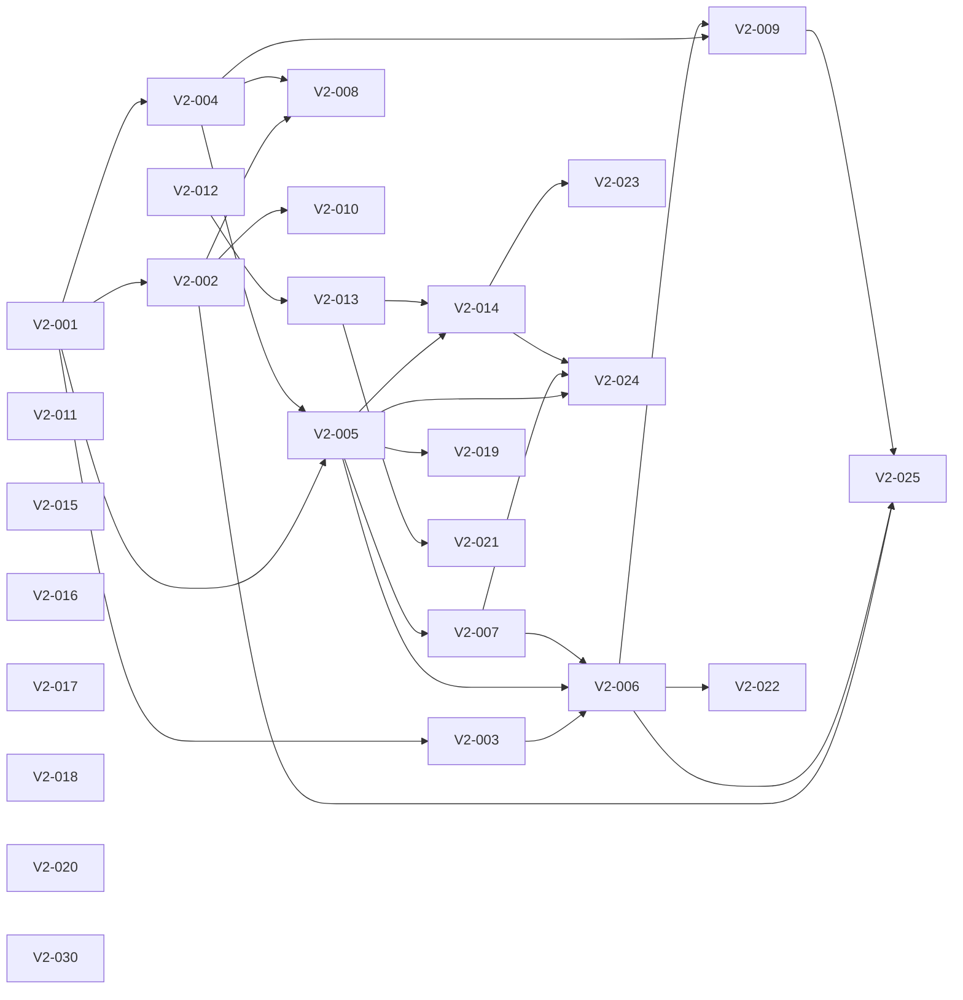

# Backlog fase 2 — Perfiles, tipos de encuesta, diseño y contenido

**Versión:** 2.1 · **Estado:** en ejecución; consultar estados y reservas en `tareas-futuras.md` · **Origen:** auditoría y respuestas del propietario del 28-10-2026 (decisiones D-015 a D-021).

> Este documento amplía el MVP con funciones que el [brief](brief-producto.md) dejaba fuera (§3.2, §5 y §8). El brief se conserva como fuente histórica; donde choque con este backlog, prevalecen las decisiones D-015 a D-021 de [decisiones.md](decisiones.md). El backlog del MVP ([backlog.md](backlog.md)) sigue vigente para sus tareas pendientes (MVP-005, MVP-049 a MVP-051).
>
> **El feed (épica E10) tiene el diseño acordado; falta el plazo de permanencia de cerradas.** Ver [feed-por-definir.md](feed-por-definir.md). Sólo se puede reservar su tarea de definición, V2-030.

## 1. Cómo usar este documento

- Cada tarea tiene ID `V2-NNN`, prioridad, tamaño, dependencias, descripción, requisitos y criterios de aceptación. Quien la coja no necesita más contexto que este documento, [contratos-api.md](contratos-api.md) y el código que se cita.
- **Tamaños:** S ≈ 0,5 día, M ≈ 1 día, L ≈ 2 días. Si una L crece, dividirla sin cambiar sus criterios.
- **Prioridad:** `P0` es imprescindible para la fase 2; `P1` es una mejora que no bloquea.
- Se aplican sin cambios el [protocolo de reserva, ramas y PR](../AGENTS.md), TDD obligatorio (`npm test`, `npm run test:db`, `npm run test:e2e`; ver [README](../README.md)) y la skill `impeccable` para la interfaz.
- **Toda tabla y RPC nueva** nace sin permisos (migración `harden_default_privileges`): la migración debe hacer `GRANT` explícito, activar RLS y añadir su test SQL en `supabase/tests/`. Hay que ampliar `008_privileges.test.sql` con cada RPC nueva y regenerar `src/lib/supabase/database.types.ts`.
- **Funciones SQL compartidas:** una migración que redefine una función (`create or replace`) sustituye su cuerpo entero. Si dos PR la redefinen en paralelo, la última fusionada borra en silencio los cambios de la otra, porque al ser archivos distintos git no da conflicto. Por eso las tareas que tocan la misma función están encadenadas como dependencias. Además, partir siempre del cuerpo vigente en `main` y, justo antes de fusionar, comprobar que ninguna PR fusionada entretanto ha tocado esa función. Las comprobaciones nuevas al crear o votar van en triggers `BEFORE INSERT` para no reescribir `create_poll` ni `vote_poll`.
- Al terminar una tarea, actualizar [contratos-api.md](contratos-api.md) si cambia un contrato.

## 2. Reglas de producto fijadas (resumen de D-015 a D-021)

| Tema | Regla |
|---|---|
| Modelo de datos | Se permiten tablas nuevas además de `polls`, `poll_options` y `votes` (D-015). |
| Identidad | Cada cuenta tiene un perfil con `@usuario` único y nombre visible opcional. Las encuestas se firman con `@usuario` (D-016). |
| Privacidad de cuenta | Cada perfil es **público** (por defecto) o **privado** (D-016). |
| Relaciones | Seguidores tipo Instagram: seguir es unidireccional; seguir una cuenta privada crea una **solicitud** que el dueño acepta o rechaza. «Amigos» = seguidores aceptados (D-017). |
| Quién ve qué | Cuenta pública: todo el mundo, también sin sesión, ve su perfil, sus encuestas y sus votos. Cuenta privada: sólo el propio usuario y sus seguidores aceptados ven sus encuestas y sus votos. El resto ve sólo la cabecera del perfil (@usuario, nombre y contadores) (D-017, D-018). |
| Votos en el perfil | Se muestran la encuesta y **la opción elegida** a quien pueda ver el perfil (D-018). Ver la pregunta abierta P-1. |
| Tipos de encuesta | Plantilla Sí/No; entre 2 y **6** opciones (D-019). |
| Cierre | Fecha de cierre opcional. Cerrada, no admite votos y **sus resultados pasan a ser visibles para todos** los que puedan ver la encuesta, aunque no hayan votado (D-020). |
| Regla crítica | Sigue vigente para toda encuesta **abierta**: nadie, ni el autor, obtiene agregados antes de votar. La única excepción es la encuesta cerrada (D-020). Siempre se impone en Supabase. |
| Contenido | Denuncias, categorías fijas y «Guardar para luego» (D-021). |

### Supuestos tomados por el planificador (corregibles por el propietario)

- **S-1 `@usuario`:** obligatorio. Se elige tras el primer login y hace falta tenerlo para crear, votar o seguir; explorar no lo requiere. Formato: 3–20 caracteres `[a-z0-9_]`, empieza por letra, único sin distinguir mayúsculas, con lista de nombres reservados. Se puede cambiar; los enlaces antiguos dejan de funcionar.
- **S-2 Nombre visible:** opcional, de 1 a 50 caracteres. No se usa el nombre de Google por defecto, para no publicar datos personales sin que el usuario lo decida.
- **S-3 Avatar:** iniciales sobre un color derivado del `@usuario`. No hay subida de imágenes ni foto de Google.
- **S-4 Contadores:** seguidores, seguidos y encuestas creadas son visibles también en cuentas privadas, como en Instagram.
- **S-5 Encuestas existentes:** se atribuyen al `@usuario` de su autor cuando lo elija. Mientras no lo tenga, aparecen como «Anónimo».
- **S-6 Cambio de privacidad:** pasar de pública a privada oculta de inmediato sus encuestas y votos a quien no sea seguidor aceptado. Pasar de privada a pública acepta todas las solicitudes pendientes.
- **S-7 Votar en encuestas de cuentas privadas:** sólo pueden votarlas quienes pueden verlas.
- **S-8 Denuncias:** no ocultan nada automáticamente; las revisa un moderador con el procedimiento de [moderacion.md](moderacion.md).
- **S-9 Guardadas:** la lista de guardadas es privada siempre; sólo la ve su dueño.

### Preguntas abiertas

- **P-1 Votos públicos frente a la regla crítica.** Si en un perfil se ve la opción elegida en encuestas que el visitante todavía no ha votado, recorriendo perfiles se puede intuir qué opción va ganando antes de votar. **Propuesta:** en el perfil ajeno, mostrar la opción elegida sólo en encuestas que el visitante ya ha votado o que están cerradas; en el resto, «Votó · vota para ver su elección». V2-007 implementa la propuesta salvo que el propietario indique lo contrario.

## 3. Catálogo

| ID | Título | Prioridad | Tamaño | Etiquetas | Dependencias |
|---|---|---|---|---|---|
| **E06 — Perfiles y relaciones** | | | | | |
| V2-001 | Crear tabla `profiles` y RPC de perfil | P0 | L | `database`, `security` | — |
| V2-002 | Onboarding: elegir `@usuario` tras el primer login | P0 | M | `frontend`, `auth` | V2-001 |
| V2-003 | Firmar encuestas con `@usuario` | P0 | M | `backend`, `frontend` | V2-001 |
| V2-004 | Crear tabla `follows` con solicitudes | P0 | L | `database`, `security` | V2-001 |
| V2-005 | Visibilidad de cuentas privadas en RLS y RPC | P0 | L | `database`, `security` | V2-001, V2-004 |
| V2-006 | Página de perfil `/u/[username]` | P0 | L | `frontend` | V2-003, V2-005, V2-007 |
| V2-007 | RPC de votos visibles en un perfil | P0 | M | `database`, `security` | V2-005 |
| V2-008 | Ajustes de perfil y privacidad (`/settings`) | P0 | M | `frontend` | V2-002, V2-004 |
| V2-009 | Seguidores, seguidos y solicitudes | P0 | M | `frontend` | V2-004, V2-006 |
| V2-010 | Navegación con perfil: cabecera y barra inferior móvil | P1 | M | `frontend`, `design` | V2-002 |
| **E07 — Tipos de encuesta** | | | | | |
| V2-011 | Plantilla Sí/No en el formulario | P1 | S | `frontend` | — |
| V2-012 | Permitir hasta 6 opciones | P0 | M | `database`, `frontend` | — |
| V2-013 | Fecha de cierre opcional | P0 | L | `database`, `frontend` | V2-012 |
| V2-014 | Resultados públicos al cerrarse | P0 | L | `database`, `security`, `frontend` | V2-005, V2-013 |
| **E08 — Diseño y experiencia** | | | | | |
| V2-015 | Animar las barras al revelar resultados | P1 | S | `frontend`, `design` | — |
| V2-016 | Mensaje «Coincides con el X %» tras votar | P1 | S | `frontend` | — |
| V2-017 | Modo oscuro | P1 | M | `frontend`, `design` | — |
| V2-018 | Compartir con la hoja nativa | P1 | S | `frontend` | — |
| V2-019 | Imagen OG dinámica por encuesta | P1 | M | `frontend` | V2-005 |
| **E09 — Contenido y seguridad** | | | | | |
| V2-020 | Denunciar una encuesta | P0 | M | `database`, `frontend`, `security` | — |
| V2-021 | Categorías fijas al crear y en la tarjeta | P1 | M | `database`, `frontend` | V2-013 |
| V2-022 | Guardar para luego | P1 | M | `database`, `frontend` | V2-006 |
| **E10 — Feed (en discusión)** | | | | | |
| V2-030 | Definir el feed con el propietario | P0 | M | `product`, `docs` | — |
| V2-031… | Tareas del feed, por crear al terminar V2-030 | — | — | `frontend`, `backend` | V2-030 |
| **E11 — Calidad y rendimiento** | | | | | |
| V2-023 | RPC de resultados por lotes para el feed | P1 | M | `database`, `backend` | V2-014 |
| V2-024 | Pruebas de fugas de privacidad y cierre | P0 | M | `testing`, `security` | V2-005, V2-007, V2-014 |
| V2-025 | E2E del ciclo social | P0 | M | `testing` | V2-002, V2-006, V2-009 |

Qué bloquea a qué y por cuál empezar: ver la sección 4, «Mapa de dependencias».

## 4. Mapa de dependencias

**Cómo leerlo.** «Depende de» son las tareas que tienen que estar **Completadas** (fusionadas y verificadas) antes de empezar. «Bloquea a» son las que esperan a esta. Una tarea está disponible cuando todas sus dependencias están completadas y nadie la tiene reservada en `tareas-futuras.md` de `main`.

| Tarea | Prioridad | Tamaño | Depende de | Bloquea a | Oleada |
|---|---|---|---|---|---|
| [V2-001](https://github.com/migdlp/opinion-social-media/issues/115) Crear tabla `profiles` y RPC de perfil | P0 | L | — | V2-002, V2-003, V2-004, V2-005 | 0 |
| [V2-002](https://github.com/migdlp/opinion-social-media/issues/124) Onboarding: elegir `@usuario` tras el primer login | P0 | M | V2-001 | V2-008, V2-010, V2-025 | 1 |
| [V2-003](https://github.com/migdlp/opinion-social-media/issues/125) Firmar encuestas con `@usuario` | P0 | M | V2-001 | V2-006 | 1 |
| [V2-004](https://github.com/migdlp/opinion-social-media/issues/126) Crear tabla `follows` con solicitudes | P0 | L | V2-001 | V2-005, V2-008, V2-009 | 1 |
| [V2-005](https://github.com/migdlp/opinion-social-media/issues/128) Visibilidad de cuentas privadas en RLS y RPC | P0 | L | V2-001, V2-004 | V2-006, V2-007, V2-014, V2-019, V2-024 | 2 |
| [V2-006](https://github.com/migdlp/opinion-social-media/issues/135) Página de perfil `/u/[username]` | P0 | L | V2-003, V2-005, V2-007 | V2-009, V2-022, V2-025 | 4 |
| [V2-007](https://github.com/migdlp/opinion-social-media/issues/132) RPC de votos visibles en un perfil | P0 | M | V2-005 | V2-006, V2-024 | 3 |
| [V2-008](https://github.com/migdlp/opinion-social-media/issues/129) Ajustes de perfil y privacidad (`/settings`) | P0 | M | V2-002, V2-004 | — | 2 |
| [V2-009](https://github.com/migdlp/opinion-social-media/issues/138) Seguidores, seguidos y solicitudes | P0 | M | V2-004, V2-006 | V2-025 | 5 |
| [V2-010](https://github.com/migdlp/opinion-social-media/issues/130) Navegación con perfil: cabecera y barra inferior móvil | P1 | M | V2-002 | — | 2 |
| [V2-011](https://github.com/migdlp/opinion-social-media/issues/116) Plantilla Sí/No en el formulario | P1 | S | — | — | 0 |
| [V2-012](https://github.com/migdlp/opinion-social-media/issues/117) Permitir hasta 6 opciones | P0 | M | — | V2-013 | 0 |
| [V2-013](https://github.com/migdlp/opinion-social-media/issues/127) Fecha de cierre opcional | P0 | L | V2-012 | V2-014, V2-021 | 1 |
| [V2-014](https://github.com/migdlp/opinion-social-media/issues/133) Resultados públicos al cerrarse | P0 | L | V2-005, V2-013 | V2-023, V2-024 | 3 |
| [V2-015](https://github.com/migdlp/opinion-social-media/issues/118) Animar las barras al revelar resultados | P1 | S | — | — | 0 |
| [V2-016](https://github.com/migdlp/opinion-social-media/issues/119) Mensaje «Coincides con el X %» tras votar | P1 | S | — | — | 0 |
| [V2-017](https://github.com/migdlp/opinion-social-media/issues/120) Modo oscuro | P1 | M | — | — | 0 |
| [V2-018](https://github.com/migdlp/opinion-social-media/issues/121) Compartir con la hoja nativa | P1 | S | — | — | 0 |
| [V2-019](https://github.com/migdlp/opinion-social-media/issues/134) Imagen OG dinámica por encuesta | P1 | M | V2-005 | — | 3 |
| [V2-020](https://github.com/migdlp/opinion-social-media/issues/122) Denunciar una encuesta | P0 | M | — | — | 0 |
| [V2-021](https://github.com/migdlp/opinion-social-media/issues/131) Categorías fijas al crear y en la tarjeta | P1 | M | V2-013 | — | 2 |
| [V2-022](https://github.com/migdlp/opinion-social-media/issues/139) Guardar para luego | P1 | M | V2-006 | — | 5 |
| [V2-023](https://github.com/migdlp/opinion-social-media/issues/136) RPC de resultados por lotes para el feed | P1 | M | V2-014 | — | 4 |
| [V2-024](https://github.com/migdlp/opinion-social-media/issues/137) Pruebas de fugas de privacidad y cierre | P0 | M | V2-005, V2-007, V2-014 | — | 4 |
| [V2-025](https://github.com/migdlp/opinion-social-media/issues/140) E2E del ciclo social | P0 | M | V2-002, V2-006, V2-009 | — | 6 |
| [V2-030](https://github.com/migdlp/opinion-social-media/issues/123) Definir el feed con el propietario | P0 | M | — | — | 0 |

### Oleadas

Todas las tareas de una oleada pueden hacerse en paralelo cuando la anterior está terminada (en realidad basta con que lo estén sus propias dependencias).

- **Oleada 0:** V2-001 (P0), V2-011 (P1), V2-012 (P0), V2-015 (P1), V2-016 (P1), V2-017 (P1), V2-018 (P1), V2-020 (P0), V2-030 (P0)
- **Oleada 1:** V2-002 (P0), V2-003 (P0), V2-004 (P0), V2-013 (P0)
- **Oleada 2:** V2-005 (P0), V2-008 (P0), V2-010 (P1), V2-021 (P1)
- **Oleada 3:** V2-007 (P0), V2-014 (P0), V2-019 (P1)
- **Oleada 4:** V2-006 (P0), V2-023 (P1), V2-024 (P0)
- **Oleada 5:** V2-009 (P0), V2-022 (P1)
- **Oleada 6:** V2-025 (P0)

### Camino crítico

La cadena más larga, unos 11 días de trabajo secuencial, es **V2-001 → V2-004 → V2-005 → V2-007 → V2-006 → V2-009 → V2-025**. Retrasar cualquiera de ellas retrasa el final de la fase. Si hay varios agentes, conviene que uno se dedique a esta cadena.

### Con cuál empezar

1. **Primero el camino crítico:** si V2-001 está libre, cogerla; después seguir la cadena (V2-004 → V2-005 → V2-007 → V2-006 → V2-009 → V2-025).
2. **Segundo agente, cadena de encuestas:** V2-012 → V2-013 → V2-014 (cuando V2-005 esté completada) → V2-021 / V2-023.
3. **Tercer agente, interfaz sin dependencias:** V2-011, V2-015, V2-016, V2-017, V2-018 y V2-020 no bloquean ni dependen de nada. Son buenas para huecos o para alguien que empieza.
4. **Producto:** V2-030 (definir el feed) no requiere código y puede ir en paralelo con todo.
5. Entre varias disponibles, P0 antes que P1, y la que más tareas bloquee antes que la que no bloquea ninguna.

### Grafo

## 5. Detalle de tareas

### E06 — Perfiles y relaciones

#### V2-001 — Crear tabla `profiles` y RPC de perfil

- **Prioridad:** P0 · **Tamaño:** L · **Dependencias:** — · **Bloquea a:** V2-002, V2-003, V2-004, V2-005
- **Descripción:** Tabla de perfil 1:1 con `auth.users` y funciones para crear y editar el propio perfil. Es la base de toda la épica.
- **Requisitos:**
  - Tabla `public.profiles`: `user_id uuid PK references auth.users on delete cascade`, `username text not null`, `display_name text null`, `is_private boolean not null default false`, `created_at timestamptz not null default now()`, `updated_at timestamptz not null default now()`.
  - `username`: `CHECK (username ~ '^[a-z][a-z0-9_]{2,19}$')` e índice único sobre `lower(username)`. `display_name`: entre 1 y 50 caracteres tras normalizar, o nulo.
  - Nombres reservados (rechazados con `USERNAME_RESERVED`): `admin`, `me`, `settings`, `login`, `logout`, `create`, `polls`, `u`, `api`, `auth`, `onboarding`, `opinion`, `soporte`, `support`, `moderacion`. Guardarlos en la propia función, no en una tabla.
  - RPC `upsert_my_profile(p_username text, p_display_name text)` → fila del perfil. Errores nuevos: `USERNAME_INVALID`, `USERNAME_TAKEN`, `USERNAME_RESERVED`, `DISPLAY_NAME_INVALID`. Normaliza el `username` a minúsculas.
  - RPC `set_profile_privacy(p_private boolean)`. Al pasar a pública, acepta las solicitudes pendientes (cuando exista V2-004, dejar el hueco documentado).
  - RLS: `select` de `username`, `display_name`, `is_private` y `created_at` para `anon` y `authenticated`. Sin escrituras directas. `user_id` sólo se concede si hace falta para joins internos de RPC, nunca a clientes.
  - Añadir los códigos nuevos a `src/lib/data/errors.ts` con mensajes en español y a `contratos-api.md` §2.
- **Criterios de aceptación:**
  1. Dado un usuario sin perfil, cuando llama a `upsert_my_profile('ana_23', null)`, entonces se crea su perfil con `username = 'ana_23'`.
  2. Dado `ana_23` ya en uso, cuando otro usuario pide `ANA_23`, entonces recibe `USERNAME_TAKEN`.
  3. Dado `p_username` `'1ana'`, `'an'`, `'admin'` o con espacios, entonces se rechaza con el código correspondiente y no se escribe nada.
  4. Dado `anon`, cuando intenta `insert`/`update`/`delete` en `profiles` o ejecutar las RPC, entonces se deniega.
  5. Dado cualquier cliente, cuando lee `profiles`, entonces no obtiene `user_id` ni email.

#### V2-002 — Onboarding: elegir `@usuario` tras el primer login

- **Prioridad:** P0 · **Tamaño:** M · **Dependencias:** V2-001 · **Bloquea a:** V2-008, V2-010, V2-025
- **Descripción:** Página `/onboarding` donde el usuario elige `@usuario` y, opcionalmente, nombre visible. Es obligatoria antes de crear, votar o seguir (S-1).
- **Requisitos:**
  - El callback de OAuth (`src/app/auth/callback/route.ts`) redirige a `/onboarding?next=<ruta>` si el usuario no tiene perfil, conservando `next` con la validación de `src/lib/auth/redirect.ts`.
  - Las server actions de crear y votar (y las de seguir de V2-004) devuelven un código `PROFILE_REQUIRED` si falta el perfil. La interfaz lo convierte en un enlace a `/onboarding?next=…`. Imponerlo también en la base de datos con triggers `BEFORE INSERT` en `polls` y `votes` que lancen `PROFILE_REQUIRED` (así no se reescriben `create_poll` ni `vote_poll`, que tocan otras tareas).
  - El formulario valida en cliente con las mismas reglas que V2-001 (nuevo `src/lib/validation/profile.ts`) y muestra en vivo `@usuario` y sus errores. Comprueba la disponibilidad al enviar, no en cada tecla.
  - Mobile-first, accesible y con los mismos estados que el resto (carga, error de red, nombre ocupado).
- **Criterios de aceptación:**
  1. Dado un usuario nuevo, cuando completa el login con Google, entonces llega a `/onboarding` y, tras guardar, vuelve a la ruta de la que venía.
  2. Dado un usuario sin perfil, cuando intenta votar o crear, entonces se le envía al onboarding y no se registra el voto ni la encuesta. La RPC lo rechaza aunque se llame directamente.
  3. Dado un usuario con perfil, cuando visita `/onboarding`, entonces se le redirige a `/`.
  4. Dado `@usuario` ocupado, cuando envía, entonces ve «Ese nombre ya está en uso» sin perder lo escrito.

#### V2-003 — Firmar encuestas con `@usuario`

- **Prioridad:** P0 · **Tamaño:** M · **Dependencias:** V2-001 · **Bloquea a:** V2-006
- **Descripción:** Sustituir «Anónimo» por `@usuario` enlazado a `/u/[username]` en la tarjeta y el detalle.
- **Requisitos:**
  - Exponer el autor sin dar `polls.user_id` a los clientes. Opción recomendada: vista `public.polls_with_author` (`security_invoker = true`) o una columna calculada vía RPC que devuelva `author_username` y `author_display_name`. Documentar la elegida en `contratos-api.md` §4.
  - Ampliar `PublicPoll` en `src/lib/data/types.ts` con `author: { username: string; displayName: string | null } | null` (`null` = sin perfil, que se muestra como «Anónimo», S-5).
  - Actualizar `getFeedPolls` y `getPublicPoll` (`src/lib/data/polls.ts`), `PollCard` y `PollDetailView`.
- **Criterios de aceptación:**
  1. Dado una encuesta de `@ana_23`, cuando se ve en el feed o en el detalle, entonces muestra `@ana_23` (y su nombre visible si lo tiene) con enlace a `/u/ana_23`.
  2. Dado un autor sin perfil, entonces se muestra «Anónimo» sin enlace.
  3. Dado cualquier respuesta de feed o detalle, entonces no contiene `user_id` (cubrir con test de HTML SSR como `src/app/ssr-sin-fugas.test.tsx`).

#### V2-004 — Crear tabla `follows` con solicitudes

- **Prioridad:** P0 · **Tamaño:** L · **Dependencias:** V2-001 · **Bloquea a:** V2-005, V2-008, V2-009
- **Descripción:** Relación de seguimiento unidireccional con aprobación para cuentas privadas (D-017).
- **Requisitos:**
  - Tabla `public.follows`: `follower_id uuid`, `followee_id uuid` (ambos referencian `auth.users` con `on delete cascade`), `status text check (status in ('pending','accepted'))`, `created_at`, `PRIMARY KEY (follower_id, followee_id)` y `CHECK (follower_id <> followee_id)`. Índices por `followee_id, status` y `follower_id, status`.
  - RPC, todas por `username` y nunca por `user_id` en la interfaz pública:
    - `follow_user(p_username)` → `'accepted'` si la cuenta es pública, `'pending'` si es privada. Idempotente.
    - `unfollow_user(p_username)` también cancela una solicitud pendiente.
    - `respond_follow_request(p_username, p_accept boolean)`: aceptar la convierte en `accepted`; rechazar la borra.
    - `remove_follower(p_username)`.
    - Completar en `set_profile_privacy(false)` la aceptación de las pendientes (S-6).
  - Límite anti-abuso: como máximo 200 `follow_user` por hora y cuenta (código nuevo `FOLLOW_RATE_LIMITED`; `RATE_LIMITED` tiene un mensaje específico de encuestas).
  - RLS: cada usuario lee las filas donde es `follower_id` o `followee_id`. Los contadores públicos se obtienen por RPC (V2-006), no por lectura directa.
  - Códigos nuevos: `USER_NOT_FOUND`, `CANNOT_FOLLOW_SELF`.
- **Criterios de aceptación:**
  1. Dado `@b` público, cuando `@a` lo sigue, entonces la fila queda `accepted`.
  2. Dado `@b` privado, cuando `@a` lo sigue, entonces queda `pending` y `@b` puede aceptarla o rechazarla. Sólo `@b` puede hacerlo.
  3. Dado que `@a` se intenta seguir a sí mismo, entonces recibe `CANNOT_FOLLOW_SELF`.
  4. Dado `@b` privado con solicitudes pendientes, cuando pasa a público, entonces todas quedan `accepted`.
  5. Dado un tercero `@c`, cuando consulta `follows`, entonces no ve relaciones entre `@a` y `@b`.

#### V2-005 — Visibilidad de cuentas privadas en RLS y RPC

- **Prioridad:** P0 · **Tamaño:** L · **Dependencias:** V2-001, V2-004 · **Bloquea a:** V2-006, V2-007, V2-014, V2-019, V2-024
- **Descripción:** Imponer en la base de datos que las encuestas de una cuenta privada sólo las vean su autor y sus seguidores aceptados (D-017). Es la tarea de seguridad más delicada de la fase.
- **Requisitos:**
  - Función `public.can_view_author(p_author uuid) returns boolean` (`stable`, `security definer`, `search_path = ''`): verdadera si el autor no tiene perfil o lo tiene público, si `auth.uid() = p_author` o si existe un `follows` aceptado de `auth.uid()` hacia `p_author`. Sin `EXECUTE` para clientes si no lo necesitan.
  - Sustituir la política `polls_select_published` por `status = 'published' AND can_view_author(user_id)`. `poll_options` ya hereda la visibilidad por su subconsulta: verificarlo con un test.
  - Votar: trigger `BEFORE INSERT` en `votes` que lance `POLL_UNAVAILABLE` si `can_view_author` es falsa (S-7), sin reescribir `vote_poll`. Resultados: añadir la misma comprobación en `get_poll_results`. Así, una encuesta privada es indistinguible de una inexistente.
  - Los metadatos de `/polls/[id]` (`src/app/polls/[id]/metadata.ts`) y la futura imagen OG no deben revelar la pregunta de una encuesta privada a quien no pueda verla.
  - Medir el plan de consulta del feed con `explain analyze` en dev con datos de prueba (≥ 1.000 encuestas y 50 relaciones) y añadir índices si hace falta. Registrar el resultado en la PR.
- **Criterios de aceptación:**
  1. Dado `@b` privado con una encuesta, cuando la piden `anon` o `@c` (que no lo sigue), entonces no aparece en el feed y `/polls/[id]` responde 404.
  2. Dado `@a` seguidor aceptado de `@b`, entonces la ve en el feed y en el detalle y puede votarla.
  3. Dado `@a` con solicitud pendiente, entonces no la ve.
  4. Dado `@c` que conoce el UUID, cuando llama a `vote_poll` o `get_poll_results` directamente, entonces recibe `POLL_UNAVAILABLE`.
  5. Dado que `@b` pasa de pública a privada, cuando `@c` recarga, entonces sus encuestas desaparecen.

#### V2-006 — Página de perfil `/u/[username]`

- **Prioridad:** P0 · **Tamaño:** L · **Dependencias:** V2-003, V2-005, V2-007 · **Bloquea a:** V2-009, V2-022, V2-025
- **Descripción:** Perfil con cabecera, botón de seguir y pestañas «Creadas» y «Votadas».
- **Requisitos:**
  - RPC `get_profile(p_username)` → `username`, `display_name`, `is_private`, `followers_count`, `following_count`, `polls_count`, `viewer_relation` (`'self' | 'none' | 'pending' | 'following'`) y `can_view_content boolean`. `USER_NOT_FOUND` → 404.
  - Cabecera: avatar de iniciales (S-3), nombre visible, `@usuario`, contadores (enlazan a V2-009) y botón según `viewer_relation`: Seguir / Solicitado (cancela) / Siguiendo (deja de seguir, con confirmación) / Editar perfil (propio).
  - Pestaña «Creadas»: encuestas del autor con `PollCard` y paginación por cursor como el feed (reutilizar `FeedList`).
  - Pestaña «Votadas»: usa V2-007 y muestra la opción elegida según P-1.
  - Pestaña «Guardadas» sólo en el perfil propio (cuando exista V2-022).
  - Cuenta privada sin acceso: cabecera y el mensaje «Esta cuenta es privada. Síguela para ver sus encuestas y votos».
  - La pestaña activa va en la URL (`?tab=votadas`) para poder compartirla. `/me` redirige a `/u/<propio>` o a `/onboarding`.
  - Renderizado dinámico y sin caché compartida (D-014, `cacheComponents`).
- **Criterios de aceptación:**
  1. Dado `@b` público, cuando lo abre un visitante sin sesión, entonces ve cabecera, Creadas y Votadas. El botón Seguir lleva al login.
  2. Dado `@b` privado y un visitante no seguidor, entonces sólo ve la cabecera y el aviso, y el HTML no contiene encuestas ni votos de `@b`.
  3. Dado `@a`, cuando pulsa Seguir en `@b` privado, entonces el botón pasa a «Solicitado» sin recargar.
  4. Dado un `username` inexistente, entonces responde 404.
  5. Funciona a 320 px sin scroll horizontal y con teclado.

#### V2-007 — RPC de votos visibles en un perfil

- **Prioridad:** P0 · **Tamaño:** M · **Dependencias:** V2-005 · **Bloquea a:** V2-006, V2-024
- **Descripción:** Listar las encuestas votadas por un usuario y su opción, respetando su privacidad y P-1.
- **Requisitos:**
  - RPC `get_profile_votes(p_username, p_cursor)` (`security definer`), páginas de 20 por `votes.created_at DESC, votes.id DESC`.
  - Devuelve sólo las encuestas que el visitante puede ver (`can_view_author` del autor de cada encuesta) y sólo si puede ver el perfil del votante (`self`, cuenta pública o seguidor aceptado). Si no, `PROFILE_PRIVATE`.
  - Por cada fila: datos públicos de la encuesta y del autor, `voted_at` y `option_id`. Según P-1, `option_id` sólo viene relleno si el visitante es el propio usuario, si ya votó esa encuesta o si está cerrada (V2-014). En otro caso llega `null` con `choice_hidden = true`.
  - Nunca devuelve recuentos ni porcentajes: los resultados se piden aparte con `get_poll_results`, que mantiene la regla crítica.
- **Criterios de aceptación:**
  1. Dado `@b` público que votó la opción X en la encuesta P, y `@a` que también votó P, cuando `@a` consulta, entonces ve P con la opción X.
  2. Dado `@a` que no votó P (abierta), entonces ve P con `choice_hidden = true` y sin `option_id`.
  3. Dado `@b` privado y `@c` no seguidor, entonces recibe `PROFILE_PRIVATE`.
  4. Dado que P es de una cuenta privada que el visitante no puede ver, entonces P no aparece aunque `@b` sea público.
  5. Ninguna respuesta incluye agregados.

#### V2-008 — Ajustes de perfil y privacidad (`/settings`)

- **Prioridad:** P0 · **Tamaño:** M · **Dependencias:** V2-002, V2-004 · **Bloquea a:** —
- **Descripción:** Página para cambiar el nombre visible, el `@usuario` y la privacidad.
- **Requisitos:**
  - Reutiliza la validación de V2-002 y llama a `upsert_my_profile` y `set_profile_privacy`.
  - Interruptor «Cuenta privada» con una explicación clara. Al activarlo, confirmar: «Tus encuestas y votos sólo los verán tus seguidores. Las personas que ya te siguen seguirán haciéndolo».
  - Al cambiar `@usuario`, avisar de que los enlaces antiguos dejarán de funcionar (S-1).
  - Requiere sesión; sin ella, lleva a `/login?next=/settings`.
- **Criterios de aceptación:**
  1. Dado un usuario, cuando cambia a privada y confirma, entonces `is_private = true` y su perfil se comporta como en V2-006 (criterio 2).
  2. Dado un cambio de `@usuario` a uno ocupado, entonces se muestra el error y no cambia nada.
  3. Dado privada → pública, entonces las solicitudes pendientes quedan aceptadas.

#### V2-009 — Seguidores, seguidos y solicitudes

- **Prioridad:** P0 · **Tamaño:** M · **Dependencias:** V2-004, V2-006 · **Bloquea a:** V2-025
- **Descripción:** Listas de seguidores y seguidos, y bandeja de solicitudes.
- **Requisitos:**
  - Rutas `/u/[username]/seguidores` y `/u/[username]/siguiendo`, visibles con las mismas reglas que el contenido del perfil. RPC `list_followers(p_username, p_cursor)` y `list_following(p_username, p_cursor)` con páginas de 30.
  - `/solicitudes` (sólo propio): solicitudes pendientes con Aceptar / Rechazar. Indicador con el número de pendientes en la cabecera o en la barra inferior (V2-010).
  - En la lista de seguidores propia, acción «Eliminar» (`remove_follower`).
- **Criterios de aceptación:**
  1. Dado `@b` privado y `@c` no seguidor, cuando abre sus listas, entonces ve el aviso de cuenta privada.
  2. Dado `@b` con 2 solicitudes, cuando acepta una y rechaza otra, entonces la lista se actualiza y los contadores cambian.
  3. Las listas paginan sin duplicados.

#### V2-010 — Navegación con perfil: cabecera y barra inferior móvil

- **Prioridad:** P1 · **Tamaño:** M · **Dependencias:** V2-002 · **Bloquea a:** —
- **Descripción:** Acceso al perfil propio desde la cabecera y barra de navegación inferior en móvil.
- **Requisitos:**
  - Escritorio: el `AuthButton` (`src/components/auth-button.tsx`) muestra el avatar con un menú (Mi perfil, Ajustes, Solicitudes, Cerrar sesión).
  - Móvil (< 640 px): barra fija inferior Feed · Crear · Perfil con iconos y texto, `aria-current` en la activa y respeto de `safe-area-inset-bottom`. Sin sesión, «Perfil» lleva al login.
  - Seguir `DESIGN.md` y la skill `impeccable`.
- **Criterios de aceptación:**
  1. Dado móvil con sesión, entonces la barra inferior lleva a `/`, `/create` y `/me`, y marca la ruta actual.
  2. Navegable con teclado y con lector de pantalla (nombres accesibles).
  3. No tapa contenido: el último elemento del feed queda visible por encima de la barra.

### E07 — Tipos de encuesta

#### V2-011 — Plantilla Sí/No en el formulario

- **Prioridad:** P1 · **Tamaño:** S · **Dependencias:** — · **Bloquea a:** —
- **Descripción:** Botón «Sí / No» en `PollCreationForm` que rellena dos opciones.
- **Requisitos:** sólo cliente (`src/components/poll-creation-form.tsx`). Rellena «Sí» y «No» y deja dos opciones. Si ya había texto en las opciones, pide confirmación antes de sustituirlo. Las opciones siguen siendo editables.
- **Criterios de aceptación:**
  1. Dado el formulario vacío, cuando pulsa «Sí / No», entonces hay exactamente dos opciones, «Sí» y «No».
  2. Dado que ya había opciones escritas, entonces se pide confirmación y, si se cancela, no cambia nada.

#### V2-012 — Permitir hasta 6 opciones

- **Prioridad:** P0 · **Tamaño:** M · **Dependencias:** — · **Bloquea a:** V2-013
- **Descripción:** Subir el máximo de opciones de 4 a 6 en base de datos, validación e interfaz (D-019).
- **Requisitos:**
  - Migración: cambiar `CHECK (position BETWEEN 1 AND 4)` por `BETWEEN 1 AND 6` en `poll_options`, y la validación de `create_poll` a 2–6.
  - `src/lib/validation/poll.ts` y `PollCreationForm`: añadir opciones hasta 6.
  - Revisar que `PollResults`, `LockedOptions` y `PollOption` se ven bien con 6 a 320 px.
  - Actualizar `contratos-api.md`, `005_create_poll.test.sql` y los tests de componentes.
- **Criterios de aceptación:**
  1. Dado 6 opciones válidas, cuando se publica, entonces se guardan las 6 en orden.
  2. Dado 7 opciones o una sola, cuando se llama a `create_poll` directamente, entonces se rechaza con `VALIDATION_OPTION_COUNT` (cuyo mensaje pasa a «Añade entre 2 y 6 opciones.»).
  3. Las encuestas existentes de 2–4 opciones siguen funcionando.

#### V2-013 — Fecha de cierre opcional

- **Prioridad:** P0 · **Tamaño:** L · **Dependencias:** V2-012 · **Bloquea a:** V2-014, V2-021
- **Descripción:** El autor puede fijar al crear cuándo deja de aceptar votos.
- **Requisitos:**
  - Migración: `polls.closes_at timestamptz null` con `CHECK (closes_at IS NULL OR closes_at > created_at)`. Conceder `select` de la columna a los clientes.
  - `create_poll` acepta `p_closes_at` (opcional); debe estar entre 1 hora y 30 días desde ahora (`INVALID_CLOSES_AT`). Mantener la firma anterior compatible o migrar la llamada en el mismo cambio.
  - Rechazar con `POLL_CLOSED` si `now() >= closes_at` mediante un trigger `BEFORE INSERT` en `votes`, sin reescribir `vote_poll`.
  - Formulario: selector «Sin cierre / 1 hora / 1 día / 3 días / 7 días / Personalizada» (fecha y hora local, enviada en UTC).
  - Tarjeta y detalle: «Cierra en 3 h» o «Cerrada hace 2 días» (ampliar `src/lib/utils/date.ts`). Una encuesta cerrada no muestra el selector de voto.
  - Sin edición: la fecha no se puede cambiar después (brief §3.3).
- **Criterios de aceptación:**
  1. Dado `closes_at` dentro de 30 min, cuando se crea, entonces se rechaza con `INVALID_CLOSES_AT`.
  2. Dado una encuesta con `closes_at` pasado, cuando alguien vota (también por RPC directa), entonces recibe `POLL_CLOSED` y no se inserta voto.
  3. Dado una encuesta abierta con cierre, entonces la tarjeta muestra el tiempo restante.
  4. Hay test SQL del límite exacto: un voto en `closes_at - 1 s` entra y uno en `closes_at` no.

#### V2-014 — Resultados públicos al cerrarse

- **Prioridad:** P0 · **Tamaño:** L · **Dependencias:** V2-005, V2-013 · **Bloquea a:** V2-023, V2-024
- **Descripción:** Excepción D-020 a la regla crítica: una encuesta cerrada muestra resultados a cualquiera que pueda verla, sin necesidad de voto ni de sesión.
- **Requisitos:**
  - Partir del `get_poll_results` que deja V2-005. Si `closes_at <= now()`, omite la comprobación de voto (y la de sesión) pero mantiene `status = 'published'` y `can_view_author`. `my_option_id` es `null` para quien no votó o no tiene sesión. Conceder `EXECUTE` a `anon` y ajustar `008_privileges.test.sql`.
  - Si la encuesta está abierta, el comportamiento no cambia en nada: `AUTH_REQUIRED` / `NOT_VOTED`.
  - `PollViewerState` gana `{ kind: "closed"; results: PollResults }` (o equivalente documentado en `contratos-api.md` §5). El feed y el detalle muestran resultados en las cerradas.
  - Actualizar la regla crítica en `AGENTS.md`, `contratos-api.md` y `seguridad-rpc.md` citando D-020.
- **Criterios de aceptación:**
  1. Dado una encuesta abierta, cuando `anon` o un usuario sin voto piden resultados, entonces se rechaza como hasta ahora (los tests de fugas existentes siguen en verde).
  2. Dado una encuesta cerrada, cuando `anon` abre el detalle, entonces ve votos, porcentajes y total.
  3. Dado una encuesta cerrada de una cuenta privada, cuando la pide un no seguidor, entonces recibe `POLL_UNAVAILABLE`.
  4. Dado una encuesta un segundo antes de cerrar, entonces el HTML SSR no contiene agregados.

### E08 — Diseño y experiencia

#### V2-015 — Animar las barras al revelar resultados

- **Prioridad:** P1 · **Tamaño:** S · **Dependencias:** — · **Bloquea a:** —
- **Descripción:** Tras votar, las barras de `PollResults` crecen desde 0 hasta su porcentaje.
- **Requisitos:** sólo CSS (transición de `width` o `transform: scaleX`), unos 600 ms escalonados por opción. Sólo se anima justo después de votar, no al cargar resultados ya conocidos. Desactivada con `prefers-reduced-motion: reduce`. Las cifras son accesibles desde el principio (no se anima el texto para lectores de pantalla).
- **Criterios de aceptación:**
  1. Dado un voto recién emitido, entonces las barras se animan una vez.
  2. Dado `prefers-reduced-motion`, entonces aparecen sin animación.
  3. Dado que se recarga una encuesta ya votada, entonces no se anima.

#### V2-016 — Mensaje «Coincides con el X %» tras votar

- **Prioridad:** P1 · **Tamaño:** S · **Dependencias:** — · **Bloquea a:** —
- **Descripción:** Frase bajo los resultados con el porcentaje de quienes eligieron lo mismo.
- **Requisitos:** se calcula en cliente con los resultados autorizados (`my_option_id` y su `percentage`); no hace falta una consulta nueva. Textos: «Eres el primero en votar» si `total = 1`; «Coincides con el X % (N personas)» en otro caso. Se anuncia con `aria-live="polite"`.
- **Criterios de aceptación:**
  1. Dado que el usuario votó la opción con 42,5 %, entonces ve «Coincides con el 42,5 %».
  2. Dado `total = 1`, entonces ve «Eres el primero en votar».
  3. Dado que no hay voto propio (encuesta cerrada sin votar, V2-014), entonces no se muestra.

#### V2-017 — Modo oscuro

- **Prioridad:** P1 · **Tamaño:** M · **Dependencias:** — · **Bloquea a:** —
- **Descripción:** Tema oscuro según la preferencia del sistema.
- **Requisitos:** redefinir los tokens de `src/app/globals.css` bajo `@media (prefers-color-scheme: dark)`. Revisar todos los componentes, que no deben usar colores fuera de los tokens. Contraste AA (4,5:1 en texto, 3:1 en barras y bordes con significado). Sin selector manual en esta tarea. Actualizar `DESIGN.md`.
- **Criterios de aceptación:**
  1. Con el sistema en oscuro, todas las rutas se ven en oscuro sin texto ilegible.
  2. Hay un E2E o una captura de Playwright de `/` y `/polls/[id]` con `colorScheme: 'dark'`.
  3. El contraste medido de los pares de tokens cumple AA (registrar la tabla en la PR).

#### V2-018 — Compartir con la hoja nativa

- **Prioridad:** P1 · **Tamaño:** S · **Dependencias:** — · **Bloquea a:** —
- **Descripción:** Botón «Compartir» que usa `navigator.share` cuando existe y, si no, copia el enlace como ahora.
- **Requisitos:** ampliar `src/components/copy-link-button.tsx` o crear `share-button.tsx`. Comparte el título (la pregunta) y la URL, nunca resultados. Cancelar la hoja nativa no muestra un error.
- **Criterios de aceptación:**
  1. Dado un navegador con `navigator.share`, cuando pulsa, entonces se abre la hoja nativa con la URL de la encuesta.
  2. Dado un navegador sin él, entonces se copia el enlace y se confirma «Enlace copiado».
  3. Dado que el usuario cancela, entonces no aparece ningún error.

#### V2-019 — Imagen OG dinámica por encuesta

- **Prioridad:** P1 · **Tamaño:** M · **Dependencias:** V2-005 · **Bloquea a:** —
- **Descripción:** Imagen de vista previa con la pregunta y las opciones para los enlaces compartidos.
- **Requisitos:** `opengraph-image.tsx` en `src/app/polls/[id]/` con `next/og` (consultar `node_modules/next/dist/docs/`). Muestra la pregunta, las opciones y `@autor`, **sin cifras** aunque esté cerrada. Para una encuesta inexistente, oculta o privada, imagen genérica de la marca. Se lee con el cliente anónimo, de modo que sólo salen las públicas.
- **Criterios de aceptación:**
  1. Dado una encuesta pública, entonces `/polls/[id]/opengraph-image` devuelve una imagen PNG de 1200×630 con la pregunta.
  2. Dado una encuesta privada u oculta, entonces devuelve la imagen genérica.
  3. Ninguna imagen contiene recuentos ni porcentajes.

### E09 — Contenido y seguridad

#### V2-020 — Denunciar una encuesta

- **Prioridad:** P0 · **Tamaño:** M · **Dependencias:** — · **Bloquea a:** —
- **Descripción:** Cualquier usuario con sesión puede denunciar una encuesta. Las denuncias alimentan la moderación manual (S-8).
- **Requisitos:**
  - Tabla `public.poll_reports`: `id uuid PK`, `poll_id uuid references polls on delete cascade`, `reporter_id uuid references auth.users on delete cascade`, `reason text check (reason in ('spam','odio','acoso','sexual','violencia','otro'))`, `details text null` (≤ 500), `created_at` y `UNIQUE (poll_id, reporter_id)`.
  - RPC `report_poll(p_poll_id, p_reason, p_details)`: exige sesión, que la encuesta sea visible para quien denuncia y como máximo 20 denuncias por hora (`REPORT_RATE_LIMITED`). Si ya la había denunciado, responde `ALREADY_REPORTED`.
  - Sin lectura para clientes. Ampliar `docs/moderacion.md` con la consulta de denuncias agrupadas por encuesta y el paso de ocultar.
  - Interfaz: menú «⋯» en tarjeta y detalle → «Denunciar» → diálogo accesible con los motivos y un texto opcional → «Gracias, lo revisaremos».
- **Criterios de aceptación:**
  1. Dado un usuario, cuando denuncia, entonces se guarda una fila. Si repite, recibe `ALREADY_REPORTED` y no se duplica.
  2. Dado `anon`, cuando pulsa Denunciar, entonces se le lleva al login.
  3. Dado cualquier cliente, cuando lee `poll_reports`, entonces se deniega.
  4. El diálogo atrapa el foco, se cierra con Escape y devuelve el foco al botón.

#### V2-021 — Categorías fijas al crear y en la tarjeta

- **Prioridad:** P1 · **Tamaño:** M · **Dependencias:** V2-013 · **Bloquea a:** —
- **Descripción:** Cada encuesta puede tener una categoría de una lista cerrada. El filtrado del feed por categoría se decide en E10.
- **Requisitos:**
  - Tabla `public.categories` (`slug text PK`, `name text`, `position smallint`) con datos iniciales en la migración: `deportes`, `tecnologia`, `politica`, `entretenimiento`, `ciencia`, `estilo-de-vida`, `otros`. Lectura pública, sin escrituras.
  - `polls.category_slug text null references categories`. `create_poll` acepta `p_category` (opcional) y valida que exista.
  - Formulario: selector opcional. Tarjeta y detalle: etiqueta con la categoría.
- **Criterios de aceptación:**
  1. Dado una categoría válida, cuando se crea la encuesta, entonces se guarda y aparece en la tarjeta.
  2. Dado `p_category = 'inventada'`, entonces `create_poll` lo rechaza.
  3. Sin categoría, la encuesta se crea igual y no muestra etiqueta.

#### V2-022 — Guardar para luego

- **Prioridad:** P1 · **Tamaño:** M · **Dependencias:** V2-006 · **Bloquea a:** —
- **Descripción:** Marcar encuestas para volver a ellas. La lista es privada (S-9).
- **Requisitos:**
  - Tabla `public.saved_polls` (`user_id`, `poll_id`, `created_at`, `PK (user_id, poll_id)`, ambos con `on delete cascade`). RLS: cada usuario lee, inserta y borra sólo sus filas; `insert` sólo si la encuesta es visible para él.
  - Botón de marcador en tarjeta y detalle, que cambia de estado al instante y revierte si falla. Sin sesión, lleva al login.
  - Pestaña «Guardadas» en el perfil propio (V2-006), paginada y con el estado de voto de cada encuesta.
- **Criterios de aceptación:**
  1. Dado un usuario, cuando guarda y quita, entonces la fila se crea y se borra.
  2. Dado otro usuario, cuando consulta `saved_polls`, entonces no ve las guardadas ajenas.
  3. Dado que una encuesta guardada pasa a no visible (oculta o cuenta privada), entonces deja de aparecer en Guardadas.

### E10 — Feed (por definir)

El diseño del feed está **por definir**. Todo el contexto, la propuesta inicial, las preguntas abiertas y el procedimiento para continuar la definición están en [feed-por-definir.md](feed-por-definir.md). Cualquier agente o persona puede retomarlo desde ahí.

#### V2-030 — Definir el feed con el propietario

- **Prioridad:** P0 · **Tamaño:** M · **Dependencias:** — · **Bloquea a:** —
- **Descripción:** Tarea de producto y documentación, sin código. Cerrar con el propietario cómo será el feed y convertir el resultado en tareas implementables.
- **Requisitos:**
  - Seguir el procedimiento de [feed-por-definir.md](feed-por-definir.md) §5: plantear las preguntas abiertas al propietario, registrar cada respuesta como decisión (D-022 en adelante) y actualizar el documento.
  - Crear en este backlog las tareas `V2-031` en adelante con el mismo formato (requisitos, criterios y dependencias, incluidas las de E06–E09 que correspondan), añadirlas a `tareas-futuras.md` y crear sus issues.
  - No implementar nada del feed dentro de esta tarea.
- **Criterios de aceptación:**
  1. Todas las preguntas de `feed-por-definir.md` §4 tienen una respuesta registrada del propietario o están descartadas por él de forma explícita.
  2. Existen tareas V2-031+ con criterios Dado/Cuando/Entonces y dependencias, y sus issues están enlazadas.
  3. `feed-por-definir.md` pasa a estado «Definido» y enlaza las tareas.

### E11 — Calidad y rendimiento

#### V2-023 — RPC de resultados por lotes para el feed

- **Prioridad:** P1 · **Tamaño:** M · **Dependencias:** V2-014 · **Bloquea a:** —
- **Descripción:** Hoy, con sesión, cada página del feed hace una llamada a `get_poll_results` por encuesta votada, hasta 20 (`src/lib/data/operations.ts`, `getFeedPage`). Sustituirlas por una sola.
- **Requisitos:** RPC `get_feed_results(p_poll_ids uuid[])` (máximo 20 IDs) que aplique **por cada encuesta** exactamente la misma autorización que `get_poll_results` y devuelva sólo las autorizadas, sin error por las demás. Tests SQL de que una lista mezclada no filtra agregados de las no votadas.
- **Criterios de aceptación:**
  1. Dado un lote con encuestas votadas y no votadas, entonces sólo llegan resultados de las votadas (y de las cerradas cuando exista V2-014).
  2. `getFeedPage` hace como máximo 3 consultas por página (encuestas, votos propios y resultados), verificado con el fake de `src/lib/data/testing/fake-supabase.ts`.
  3. Los tests de fugas existentes siguen en verde.

#### V2-024 — Pruebas de fugas de privacidad y cierre

- **Prioridad:** P0 · **Tamaño:** M · **Dependencias:** V2-005, V2-007, V2-014 · **Bloquea a:** —
- **Descripción:** Ampliar la batería de ataques (MVP-044, `npm run test:security`) con las vías nuevas.
- **Requisitos:** con cuentas diferenciadas (pública, privada, seguidor aceptado, seguidor pendiente, extraño y anon), intentar por REST y RPC directas: leer encuestas, opciones, votos, perfiles, follows, denuncias y guardadas ajenas; votar y pedir resultados en encuestas privadas, cerradas y abiertas; enumerar `username` → `user_id`. Comprobar también el HTML SSR de `/u/[username]`.
- **Criterios de aceptación:**
  1. Cada vía tiene un test que falla si se abre la fuga (demostrado con una mutación que se revierte, como en MVP-045/046).
  2. El job de CI de ataques corre en verde.

#### V2-025 — E2E del ciclo social

- **Prioridad:** P0 · **Tamaño:** M · **Dependencias:** V2-002, V2-006, V2-009 · **Bloquea a:** —
- **Descripción:** Recorrido Playwright en escritorio y móvil (infraestructura de MVP-045).
- **Requisitos:** usuario nuevo → onboarding → crea una encuesta → otro usuario privado → el primero le envía una solicitud y no ve sus encuestas → el privado acepta → ahora las ve y vota → visita el perfil y ve la encuesta en «Votadas».
- **Criterios de aceptación:**
  1. El recorrido pasa en escritorio y móvil en dos ejecuciones seguidas.
  2. Rompe (RED) si se elimina la comprobación de `can_view_author` en la política de `polls`.

### E10 — Implementación del feed acordado

**Borrador listo para convertir en issues al cerrar V2-030.** Dependencias y criterios derivan de D-022 a D-025. Tamaños relativos: S ≈ 0,5 día, M ≈ 1 día, L ≈ 2 días. No son compromisos ni sprints. Todas P0 para entregar el feed pedido, sin bloquear el MVP original ya definido.

#### V2-031 — Lectura de feed con seguimientos, categoría y retención

- **Prioridad:** P0 · **Tamaño:** L · **Etiquetas:** backend, database, security · **Dependencias:** V2-030, V2-005, V2-014, V2-021 · **Bloquea a:** V2-032, V2-034, V2-035.
- **Descripción:** Implementar una lectura RPC controlada y su adaptador/tipos para Recientes y Siguiendo, filtro de categoría y exclusión temporal de cerradas. Reutilizar permisos, catálogo de categorías y contratos de encuesta; migración versionada y pruebas SQL primero.
- **Requisitos:** Recientes contiene todas las encuestas visibles; Siguiendo sólo autores seguidos con relación aceptada por el usuario autenticado (sin parámetro de identidad del visitante). Ambas cronológicas, 20 por página, cursor compuesto `created_at,id`; categoría validada o Todas. Incluir autor sin exponer `user_id`. Filtrar cerradas con el plazo de D-025 (pendiente de concretar), calculado con hora del servidor; nunca borrar filas. No enviar agregados de abiertas no votadas; mantener RPC segura de resultados y lectura del voto propio. Sin caché compartida de datos personales. Permisos mínimos, RLS y search_path seguros.
- **Criterios:**
  1. Dado anon, seguidor aceptado, pendiente y extraño, cuando consultan ambos modos, entonces sólo reciben las encuestas visibles y Siguiendo deniega anon sin revelar otras cuentas.
  2. Dadas fechas iguales y más de 20 encuestas, cuando se recorren páginas, entonces el orden es estable y no hay duplicados; un cursor/filtro inválido produce error controlado.
  3. Dada categoría concreta o Todas, cuando se consulta, entonces cada página y su cursor respetan ese filtro.
  4. Dado el límite exacto de D-025, cuando la hora del servidor alcanza `closes_at + plazo`, entonces la encuesta deja el feed sin desaparecer de detalle/perfil; test con reloj SQL fijado. Una encuesta sin fecha de cierre no caduca por este filtro.
  5. Dadas abiertas sin votar, votadas y cerradas, entonces sólo las autorizadas contienen resultados, sin lecturas directas de votos ajenos; tipos regenerados y pruebas SQL/adaptador en verde.

#### V2-032 — Pestañas, entrada por defecto y filtro de categoría

- **Prioridad:** P0 · **Tamaño:** M · **Etiquetas:** frontend, design · **Dependencias:** V2-030, V2-031 · **Bloquea a:** V2-034, V2-036.
- **Descripción:** Integrar Recientes/Siguiendo y categorías en `/`, con selección en URL, teclado, estados de carga, error y vacío; conservar el diseño y la navegación móvil.
- **Criterios:**
  1. Dado visitante sin selección explícita, cuando entra, entonces ve Recientes; dado usuario con seguimiento aceptado ve Siguiendo, y sin ninguno ve Recientes.
  2. Dado un usuario que sigue cuentas sin encuestas visibles, entonces Siguiendo permanece seleccionado y ofrece ir a Recientes; las solicitudes pendientes no cuentan como aceptadas.
  3. Dada selección explícita permitida de pestaña/categoría, entonces persiste al recargar o copiar la URL, y cambiarla descarta cursor/filas anteriores sin mezclar respuestas tardías.
  4. Dado teclado/lector de pantalla, entonces las pestañas y Todas/categorías tienen nombres y estado seleccionado accesibles y funcionan a 320px sin desbordamiento.

#### V2-033 — Voto seguro desde la tarjeta del feed

- **Prioridad:** P0 · **Tamaño:** M · **Etiquetas:** frontend, auth, testing · **Dependencias:** V2-030, V2-014 · **Bloquea a:** V2-035, V2-036.
- **Descripción:** Reutilizar selección, acción de voto, lectura autorizada y resultados del detalle dentro de la tarjeta, manteniendo enlace compartible y autor. Sin nueva vía de autorización ni voto automático después de login.
- **Criterios:**
  1. Dada abierta no votada, entonces HTML, props y respuestas no contienen cifras; al seleccionar y confirmar se guarda un voto y aparecen resultados en esa tarjeta.
  2. Dado visitante, cuando intenta votar, entonces se autentica y recupera feed/encuesta/opción sin emitir voto hasta confirmar.
  3. Dado voto duplicado, doble clic o respuesta perdida, entonces se consulta el voto propio y se recuperan resultados sin cambiar ni duplicar votos.
  4. Dadas votadas o cerradas visibles, entonces muestran resultados desde la carga y las cerradas no admiten voto. Las opciones tienen etiquetas, foco y feedback accesibles; acciones no quedan dentro de otro enlace.

#### V2-034 — Scroll infinito con botón alternativo

- **Prioridad:** P0 · **Tamaño:** M · **Etiquetas:** frontend, testing, design · **Dependencias:** V2-031, V2-032 · **Bloquea a:** V2-036.
- **Descripción:** Cargar la página siguiente al acercarse al final con IntersectionObserver y botón «Cargar más» siempre disponible; reutilizar cursor y estados. Sin librería ni caché externa.
- **Criterios:**
  1. Dadas más de 20 encuestas, cuando el final entra en pantalla o se pulsa el botón, entonces se añade la siguiente página con una sola petición en vuelo y sin duplicados.
  2. Dado IntersectionObserver no disponible, entonces el botón permite recorrer todas las páginas y muestra fin de lista cuando no hay cursor.
  3. Dado fallo de red o filtros cambiados durante una petición, entonces se conservan filas válidas, se puede reintentar y se descartan respuestas de la selección antigua.
  4. Dado lector de pantalla/teclado, entonces se anuncia la carga sin robar el foco, el botón es usable y la última tarjeta queda por encima de la barra móvil. Ningún error provoca un bucle de peticiones.

#### V2-035 — Ataques a la privacidad del nuevo feed

- **Prioridad:** P0 · **Tamaño:** M · **Etiquetas:** security, testing, backend · **Dependencias:** V2-031, V2-033, V2-024 · **Bloquea a:** V2-036.
- **Descripción:** Extender la batería SQL/HTTP existente a modos, categorías, cursores y voto en tarjeta; cubrir HTML/Flight y respuestas de acciones además de RPC directas. Preparar pruebas junto con la implementación.
- **Criterios:**
  1. Dadas cuentas pública, privada, seguidor aceptado, pendiente, extraño y anon, cuando manipulan filtros/cursores/IDs o llaman directamente al backend, entonces no obtienen encuestas privadas, ocultas ni resultados de abiertas sin votar.
  2. Dada mezcla de abiertas/cerradas/votadas, entonces los agregados sólo llegan a quien tiene permiso, también en HTML SSR/Flight y al cargar páginas adicionales.
  3. Dadas peticiones simultáneas desde dos tarjetas/pestañas, entonces persiste un único voto y los errores no contienen SQL ni datos personales.
  4. Se demuestra RED retirando una comprobación de visibilidad en una base local efímera, se revierte la mutación y pasan los jobs de seguridad y SQL. No se modifica dev ni prod para provocar fallos.

#### V2-036 — E2E y cierre del feed

- **Prioridad:** P0 · **Tamaño:** M · **Etiquetas:** testing, frontend, devops · **Dependencias:** V2-032, V2-033, V2-034, V2-035 · **Bloquea a:** —.
- **Descripción:** Probar el recorrido completo en móvil/escritorio con Supabase local y actualizar README/contratos/checklist para que el feed se pueda publicar junto a una release autorizada. No crear deployments como prueba.
- **Criterios:**
  1. Dado visitante, usuario sin seguimientos y usuario con seguimientos aceptados, entonces se verifica la entrada correcta, cambio de pestañas, filtro y más de una página con scroll y botón.
  2. Dado voto desde tarjeta y una recarga, entonces la elección persiste y se ven resultados; dado cierre/retención se verifica presencia y retirada temporal sin perder acceso directo autorizado.
  3. Dadas peticiones lentas, doble clic, error de red, reduced-motion y teclado a 320px/escritorio, entonces se conservan foco/estado, no hay solapamiento y se puede continuar.
  4. Playwright pasa dos ejecuciones seguidas en ambos proyectos, CI completa verde; documentación y checklist enlazan evidencias y contemplan la comprobación posterior en producción por el flujo release autorizado.

## 6. Registro

El estado de cada tarea se lleva en [tareas-futuras.md](tareas-futuras.md), sección «Fase 2», con el mismo protocolo de reserva del MVP. Issues: épicas #109–#114 y tareas #115–#140 (tabla en [github-issues.md](github-issues.md#fase-2)). Cada issue repite sus dependencias y a quién bloquea.
