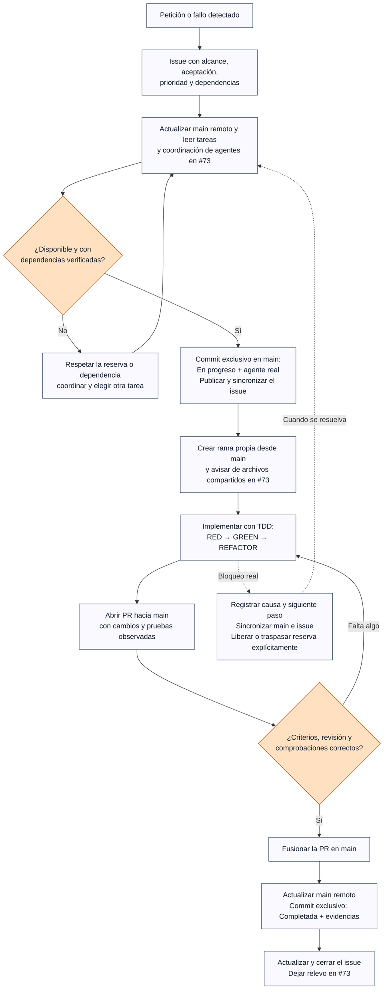
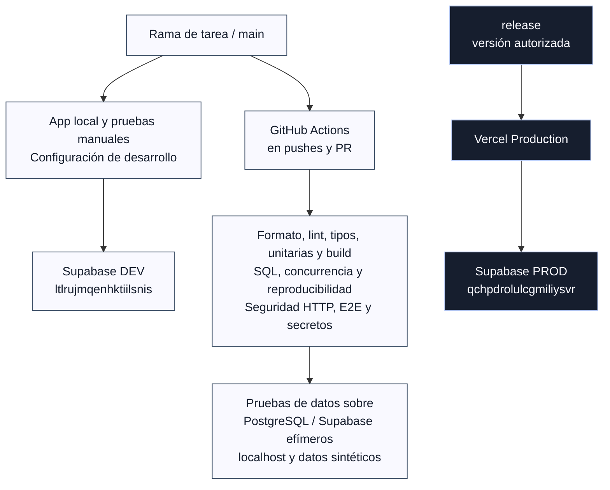
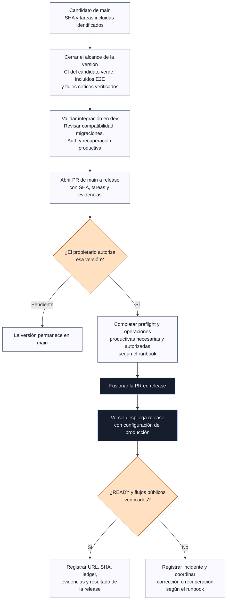

# Flujo de trabajo del proyecto

[← Volver al repositorio](../README.md) · [Tareas y responsables](tareas-futuras.md) · [Coordinación de agentes #73](https://github.com/migdlp/opinion-social-media/issues/73) · [Acciones de CI](https://github.com/migdlp/opinion-social-media/actions)

Este mapa describe el proceso vigente a **30 de octubre de 2026**, según [AGENTS.md](../AGENTS.md). Los diagramas se muestran directamente en GitHub con Mermaid. `main` integra el desarrollo; `release` contiene la versión publicada. **Fusionar una tarea en `main` no publica la aplicación.**

## De la petición a una tarea terminada

Se eligen P0 disponibles antes de P1, respetando el encargo concreto del propietario. Cada agente trabaja con su identificador real y reserva antes de implementar; no ocupa tareas de otra IA. Un push rechazado obliga a releer `main`, comprobar la reserva y rehacer la actualización sin forzar.

Las reservas, cambios de estado y traspasos llevan **commits exclusivos directamente a `main`**. El código y el resto de la documentación pasan por rama y PR. Al terminar se conserva el agente como autor de la tarea completada; eso no mantiene una reserva activa. Una sesión interrumpida tampoco libera automáticamente una tarea ajena.

TDD se aplica al comportamiento: la prueba falla por el problema real antes de implementar, pasa con el cambio y sigue pasando al refactorizar. La documentación se comprueba por contenido, coherencia, enlaces y render; no se inventa un ciclo TDD de aplicación. Las pruebas y bloqueos quedan registrados en el issue y la PR.

## Dónde se desarrolla y dónde se prueba

| Destino                                       | Uso y límites                                                                                                                                                 |
| --------------------------------------------- | ------------------------------------------------------------------------------------------------------------------------------------------------------------- |
| Rama de tarea                                 | Código/documentación aislados, PR hacia `main`. No despliega en Vercel.                                                                                       |
| `main`                                        | Integración y registro compartido de tareas. Puede contener funciones aún pendientes de activar en dev o publicar.                                            |
| Supabase dev                                  | Desarrollo y pruebas manuales alojadas. Organización **Los tres cerditos**, Irlanda. Migraciones sólo dentro de su tarea y con las verificaciones necesarias. |
| Supabase/PostgreSQL local o de CI             | Suites automáticas con datos sintéticos; no prueban contra las bases alojadas dev/prod.                                                                       |
| Vercel Preview                                | Desactivado para ahorrar cuota. Tener variables Preview configuradas con dev no crea una URL de preview.                                                      |
| `release` + Vercel Production + Supabase prod | Versión pública. No se usa para desarrollar ni para suplir migraciones que falten en dev.                                                                     |

La configuración efectiva está en [vercel.json](../vercel.json), [el guard de build](../scripts/vercel-ignore-build.mjs), [la pipeline](../.github/workflows/ci.yml) y [la guía de entornos](entornos.md). **La CI valida migraciones en bases efímeras; no las aplica automáticamente a Supabase alojado.** Las claves publicables corresponden al proyecto de cada entorno; los secretos y `.env.local` no se guardan en Git.

## Publicar una versión

Un requisito pendiente mantiene la versión bloqueada en `main`; abrir una PR de publicación no autoriza su merge. La operación de Vercel corresponde a **Codex /root (opinion_social_media)** salvo traspaso registrado. Las operaciones de infraestructura/datos requieren la tarea y la autorización aplicables. Un despliegue READY no sustituye las pruebas funcionales; volver el frontend a una versión anterior tampoco revierte la base de datos. Los hotfixes productivos parten de `release`, llevan PR hacia `release` y después se integran en `main`.

## Cómo saber qué está pasando ahora

| Consulta                                                                  | Fuente vigente                                                                                                                               |
| ------------------------------------------------------------------------- | -------------------------------------------------------------------------------------------------------------------------------------------- |
| Qué tarea está libre, en progreso, bloqueada o completada; quién la lleva | [Registro en main](https://github.com/migdlp/opinion-social-media/blob/main/docs/tareas-futuras.md) y el issue de la tarea                   |
| Archivos compartidos, avisos y relevo entre IAs                           | [Canal #73](https://github.com/migdlp/opinion-social-media/issues/73); no sustituye la reserva                                               |
| Prioridad y dependencias                                                  | [Orden de ejecución](orden-ejecucion.md), backlog e issue; el número del issue no determina el orden                                         |
| Cambios propuestos o integrados                                           | [Pull requests](https://github.com/migdlp/opinion-social-media/pulls) y [CI](https://github.com/migdlp/opinion-social-media/actions)         |
| Qué está publicado y qué falta activar                                    | [Estado del proyecto](estado-proyecto.md), [última release documentada](rel-002-tema-cuenta.md) y [operación de Vercel](vercel-operacion.md) |
| Reglas obligatorias                                                       | [AGENTS.md](../AGENTS.md) y las instrucciones posteriores del propietario                                                                    |

**Ejemplo del bloqueo registrado al crear este mapa:** [OPS-003 #272](https://github.com/migdlp/opinion-social-media/issues/272) está bloqueada y sin reserva activa porque la revisión automática rechazó la exportación de la copia real de dev por su contenido/destino, pendientes de autorización. Sus ensayos sintéticos no equivalen a recuperar datos reales. [REL-003 #273](https://github.com/migdlp/opinion-social-media/issues/273) depende de esa integración. Consultar los issues y el registro en main para el estado posterior; este diagrama no elimina dependencias ni concede permisos para exportar, migrar o desplegar.
