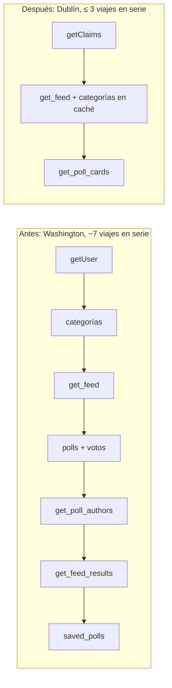

# Arquitectura

Se sigue la arquitectura existente (ver [docs/tecnica/arquitectura.md](../../tecnica/arquitectura.md)): Server Components y Server Actions de Next.js llaman a adaptadores de `src/lib/data/`, que llaman a RPC de Supabase. No se añaden dependencias ni servicios.

## Antes y después



## Contrato nuevo: `public.get_poll_cards`

Migración: `supabase/migrations/20261031120000_poll_cards.sql`.

```sql
create function public.get_poll_cards(p_poll_ids uuid[])
returns table (
  poll_id uuid,
  question text,
  created_at timestamptz,
  closes_at timestamptz,
  category_slug text,
  category_name text,
  author_username text,
  author_display_name text,
  comments_enabled boolean,
  options jsonb,        -- [{"id": uuid, "text": text, "position": int}] ordenado por position
  my_option_id uuid,    -- voto de auth.uid(); null sin sesión o sin voto
  total_votes integer,  -- null salvo resultados autorizados
  results jsonb,        -- null salvo autorizados: [{"option_id": uuid, "votes": int, "percentage": numeric}] ordenado por position
  saved boolean         -- false sin sesión
)
language sql stable security definer set search_path = ''
```

Reglas (copiadas de `get_feed` y `get_feed_results`, que no se modifican):

- Entrada: `p_poll_ids[1:20]`, sin duplicados, conservando el orden de la primera aparición (`unnest ... with ordinality`). Salida en ese orden.
- Visibilidad: `p.status = 'published' and public.can_view_author(p.user_id)`.
- Resultados autorizados: `(p.closes_at is not null and p.closes_at <= now()) or exists (voto de auth.uid() en la encuesta)`.
- `percentage`: `case when total = 0 then 0.0 else round(100.0 * votes / total, 1) end::numeric(4,1)`, igual que `get_feed_results`.
- Autor: `profiles.username` y `display_name` del autor; null si no tiene perfil.
- Permisos: `revoke execute ... from public; grant execute ... to anon, authenticated;`.
- Nunca devuelve `user_id`, fechas de voto ni datos de otros votantes.

## Adaptador

En `src/lib/data/operations.ts`:

- `getPollCards(supabase, ids: string[], signedIn: boolean): Promise<Result<FeedItem[]>>`. Convierte cada fila con `toFeedItem`:
  - `results` presente y `my_option_id` presente → `{ kind: "voted", results }`.
  - `results` presente sin `my_option_id` → `{ kind: "closed", results, signedIn }`.
  - `results` nulo y `signedIn` → `{ kind: "not_voted" }`; si no, `{ kind: "anonymous" }`.
  - `saved` sólo se incluye si `signedIn`.
- `getFeed`, `getProfilePolls`, `searchPolls`, `getSavedPolls` y `getPollDetail` pasan a usarlo. Las funciones privadas `withOwnVotes`, `withViewerStates`, `getFeedResults`, `markSaved` e `isSaved` se borran cuando ya no tengan llamadores.

## Decisiones (ADR)

### ADR-001 · Región `dub1`
- Contexto: Supabase prod en `eu-west-1`; funciones en `iad1`.
- Opciones: `dub1` (misma ciudad que la BD); `cdg1` + mover Supabase a París (~15 ms menos para Madrid, exige proyecto nuevo y migración de datos, prohibido por AGENTS.md); dejar `iad1`.
- Decisión: `dub1` con `"regions": ["dub1"]` en `vercel.json`, versionado y revisado. Vercel Hobby admite una sola región.
- Consecuencias: el viaje móvil → función sube unos ms para EE. UU. y baja para Europa; los viajes función → BD bajan a ~1–2 ms.

### ADR-002 · Una RPC de tarjetas reutilizable en lugar de una RPC por pantalla
- Opciones: `get_feed_page` que fusione ids + tarjetas (1 viaje) frente a `get_poll_cards` reutilizable (2 viajes).
- Decisión: `get_poll_cards`. Un único contrato para feed, detalle, perfil, guardados y búsqueda; con `dub1` el viaje extra cuesta ~1–2 ms.

### ADR-003 · Sesión con `getClaims()`
- `auth.getClaims()` verifica el JWT localmente cuando el proyecto usa claves asimétricas (JWKS); con claves simétricas hace la misma llamada de red que `getUser()`, así que nunca empeora. La autorización real sigue en RLS con el JWT.
- PA-1 decide si hay ganancia real; la tarea no se bloquea por ello.

### ADR-004 · Usuarios fuera de Europa (sólo documentado)
- Hoy: una región (Dublín). Un usuario lejano paga un único viaje largo móvil → función; los viajes función → BD siguen siendo cortos.
- Disparador para revisar: más del 20 % de sesiones fuera de Europa durante 4 semanas, o mediana del feed > 1 s en esa región.
- Entonces: réplicas de lectura de Supabase (plan de pago) en la región lejana + funciones de Vercel Pro en esa región para rutas de lectura. Las escrituras y Auth siguen yendo a la principal. Las RPC deben llamarse por GET (`rpc(..., { get: true })`) para usar réplicas, y justo después de votar los resultados se leen de la principal por el retraso de replicación.

## Entornos y despliegue

- Tests: Supabase/PostgreSQL efímeros (`npm run test:db`, `test:security`, `test:e2e`). Nada contra bases alojadas.
- La migración `20261031120000_poll_cards.sql` llega a dev/prod sólo por el flujo OPS/REL. Las tareas de código no aplican SQL alojado.
- PERF-003 es el único despliegue de este plan fuera de REL, autorizado por el propietario el 31-10-2026 (D-043).
