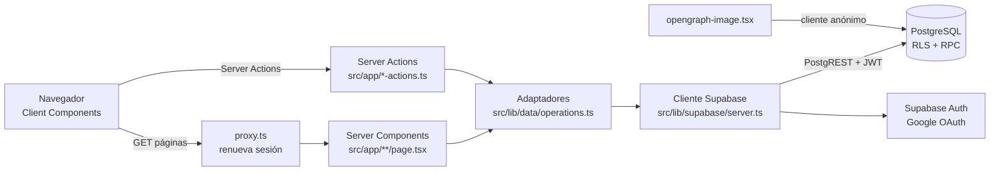
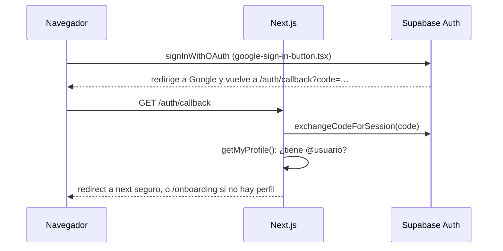
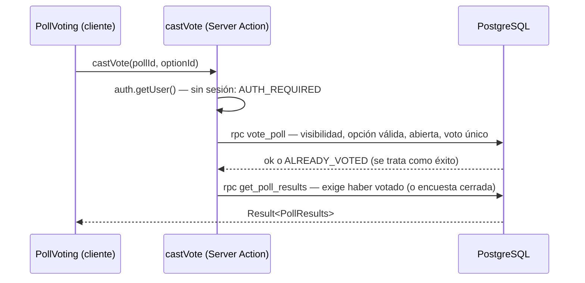

# Arquitectura

## Visión general

Monolito **Next.js full-stack sin backend propio**: no hay Express, API REST propia, colas ni Redis. Las páginas son Server Components que leen Supabase en cada petición con la sesión del usuario (cookies), y las mutaciones son Server Actions que llaman a funciones RPC de PostgreSQL. **Toda la autorización vive en la base de datos** (RLS + funciones `SECURITY DEFINER` con `search_path = ''`); el código TypeScript sólo decide qué mostrar.

El patrón en el front es por capas sencillas: rutas (`src/app/`) → acciones y adaptadores de datos (`src/lib/data/`) → cliente Supabase (`src/lib/supabase/`). Los componentes de UI (`src/components/`) no hablan con Supabase directamente: reciben datos y funciones de acción por props.

## Componentes

| Componente | Responsabilidad | Ubicación |
|---|---|---|
| Proxy (antes «middleware») | Refresca el token en cada petición y copia las cookies nuevas | `src/proxy.ts` |
| Páginas | Leen datos por petición y componen la UI | `src/app/**/page.tsx`, `feed.tsx` |
| Server Actions | Mutaciones y paginación («Cargar más»); nunca lanzan, devuelven `Result` | `src/app/*-actions.ts`, `src/app/polls/[id]/comment-actions.ts` |
| Adaptadores de datos | Única puerta a Supabase: RPC/lecturas → tipos de dominio + `AppErrorCode` | `src/lib/data/` |
| Clientes Supabase | Servidor (cookies), navegador y anónimo (sin sesión, sin caché) | `src/lib/supabase/` |
| UI | Componentes presentacionales y de interacción (voto, seguir, comentar…) | `src/components/` |
| Base de datos | Esquema, RLS, RPC, triggers: la fuente de verdad de permisos | `supabase/migrations/` |

## Flujos principales

### Inicio de sesión (Google, PKCE)

`safeNextPath` (`src/lib/auth/redirect.ts`) evita redirecciones abiertas. Sin perfil no se puede crear, votar ni seguir: lo garantizan triggers `PROFILE_REQUIRED` en la base de datos.

### Votar y ver resultados

Antes de votar, el servidor **no envía** agregados al HTML (lo comprueba `src/app/ssr-sin-fugas.test.tsx`). Tras un fallo de red, `loadOwnVote` consulta si el voto llegó antes de reintentar.

### Feed

`get_feed(p_mode, p_category, p_cursor)` devuelve sólo ids + cursor opaco; los datos de cada encuesta se leen por la RLS de `polls` y los resultados del lote con **una** llamada a `get_feed_results` (sólo de las votadas o cerradas). Paginación por cursor `(created_at, id)`, 20 por página. Las cerradas salen del feed 24 h después de cerrar, pero siguen accesibles en detalle y perfil. Ver `getFeed` en `src/lib/data/operations.ts`.

## Decisiones clave

- **Autorización en Supabase, no en la UI**: RLS en todas las tablas y escrituras sólo por RPC. Permite que el navegador hable con PostgREST sin riesgo y que los ataques directos se prueben en `tests/security/`.
- **`can_view_author(uuid)`** concentra la visibilidad (cuenta privada + seguidor aceptado + bloqueos en ambos sentidos). La usan la RLS de `polls`, el feed, perfiles, resultados, comentarios y denuncias: cambiarla afecta a todo.
- **Inexistente = privado = oculto**: todos devuelven `POLL_UNAVAILABLE`, para no filtrar existencia.
- **Sin caché de datos de sesión**: con `cacheComponents` activo, nada de `use cache` en resultados o sesión; leer cookies hace la ruta dinámica.
- **Errores como códigos**: la RPC aborta con `P0001` y el mensaje es el código; `toAppError` lo traduce y `ERROR_MESSAGES` da el texto en español (`src/lib/data/errors.ts`).
- **Dev nunca toca producción**: `getSupabaseEnv` lanza si la URL es la de producción fuera de `VERCEL_ENV=production`.
- **Producción sólo desde `release`** (D-VERCEL-002); previews desactivadas para ahorrar cuota.

## Puntos delicados

- Next.js 16 cambia convenciones (p. ej. `middleware` → `proxy`, `PageProps<"/ruta">` global). Leer `node_modules/next/dist/docs/` antes de tocar.
- Las migraciones redefinen funciones con `create or replace` en ficheros posteriores: el cuerpo vigente de una RPC es **el de la última migración que la toca** (`grep -l "function public.vote_poll" supabase/migrations/*`).
- `get_feed_results` duplica la autorización de `get_poll_results`: mantenerlas sincronizadas.
- `database.types.ts` se genera desde el esquema; CI comprueba que coincide (`scripts/check-db-reproducibility.sh`).
- La CSP está en modo *Report-Only* (`next.config.ts`) para no romper el script de tema ni el login.
