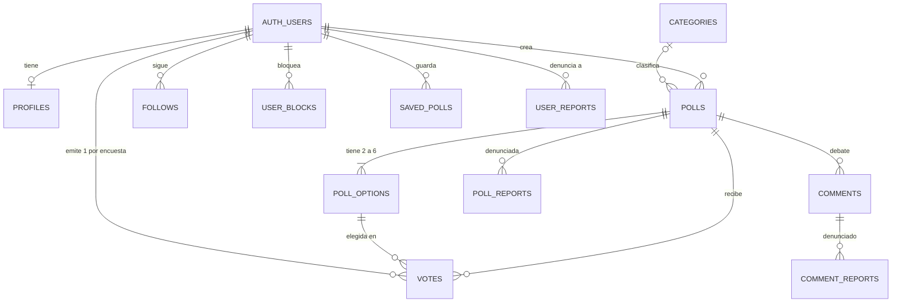

# Modelos de datos

PostgreSQL en Supabase, esquema `public` (más `private` para funciones internas y `extensions` para `pg_trgm`). Se define **sólo** con migraciones SQL en `supabase/migrations/` (sin ORM). Los tipos TypeScript del esquema se generan en `src/lib/supabase/database.types.ts`; los tipos de dominio que usa la UI están en `src/lib/data/types.ts`.

Los nombres de `polls`, `poll_options` y `votes` vienen del brief y son vinculantes: no renombrarlos.

## Núcleo de encuestas

### `polls` — `20261027193208_create_polls_and_options.sql` (+ ampliaciones)

| Campo | Tipo | Notas |
|---|---|---|
| `id` | uuid PK | |
| `user_id` | uuid FK `auth.users` | Autor. **Nunca se expone** a clientes; la autoría pública sale de `get_poll_authors` |
| `question` | text | 10–280 caracteres (puntos de código) tras normalizar |
| `status` | text | `published` \| `hidden`. `hidden` lo pone a mano un admin (ver `docs/moderacion.md`); oculta en todas partes |
| `closes_at` | timestamptz null | Cierre opcional, entre +1 h y +30 días; no editable |
| `category_slug` | text FK `categories` null | |
| `comments_enabled` | boolean | Por defecto `false`; sólo la autora lo cambia |
| `created_at` | timestamptz | Ordena el feed junto a `id` |

### `poll_options`
`id`, `poll_id`, `text` (1–100), `position` (1–6, única por encuesta). Lectura heredada de la RLS de `polls`.

### `votes`
`id`, `poll_id`, `option_id`, `user_id`, `created_at`. `UNIQUE(poll_id, user_id)` = un voto por cuenta; FK compuesta `(poll_id, option_id)` garantiza que la opción es de esa encuesta. **Inmutable**. Cada cuenta sólo lee sus propios votos (RLS). Triggers: `votes_reject_closed_poll`, `votes_require_visible_poll`, `votes_require_profile`.

### `categories`
Catálogo fijo (`slug` PK, `name`, `position`): deportes, tecnologia, politica, entretenimiento, ciencia, estilo-de-vida, otros.

## Social

| Tabla | Clave | Notas |
|---|---|---|
| `profiles` | `user_id` PK | `username` (`^[a-z][a-z0-9_]{2,19}$`, único sin mayúsculas, con lista reservada), `display_name` (1–50), `is_private`, `avatar_icon` (catálogo cerrado de 8 iconos o `null` = iniciales), `bio` (≤ 280), `vote_visibility` (`private`/`followers`/`profile`, por defecto `private`). Columnas legibles por GRANT por columna; `user_id`, `bio` y `vote_visibility` no (la bio sale por `get_profile`) |
| `follows` | (`follower_id`, `followee_id`) | `status` `pending`/`accepted`. Hacia cuentas privadas nace `pending`; al hacerse pública se aceptan todas |
| `follow_quota_events` | `id` | Registro para limitar a 200 seguimientos nuevos/hora |
| `user_blocks` | (`blocker_id`, `blocked_id`) | Bloquear cancela seguimientos mutuos; quien es bloqueado no lo ve |
| `saved_polls` | (`user_id`, `poll_id`) | Lista privada «Guardar para luego» |
| `comments` | `id` | `body` 1–1000, plano (sin hilos ni likes); 10/min por cuenta. Sólo por `list_comments` / `add_comment` |

## Moderación

`poll_reports`, `user_reports`, `comment_reports`: motivo (`spam`, `odio`, `acoso`, `sexual`, `violencia`, `otro`) + `details` ≤ 500, una denuncia por par (denunciante, objeto). **Ningún cliente las lee ni escribe** directamente; no ocultan nada automáticamente.

## Quién puede ver qué

Reglas que imponen la RLS y las RPC (resumen; detalle en `docs/contratos-api.md`):

1. **Visibilidad del autor** — `public.can_view_author(autor)`: falso si hay bloqueo en cualquier sentido; si no, verdadero si el perfil es público, es la propia cuenta o hay seguimiento aceptado. Gobierna encuestas, opciones, feed, perfil, resultados y comentarios.
2. **Resultados** — `get_poll_results` exige sesión **y voto propio** si la encuesta está abierta; si está cerrada y es visible, los ve cualquiera (D-020). Nunca devuelve identidades de votantes.
3. **Historial de votos de un perfil** — `get_profile_votes` según `vote_visibility` del dueño y la relación de quien mira.
4. **Comentarios** — en abiertas, leer y escribir exige haber votado; en cerradas, basta con poder ver la encuesta.
5. **Inexistente, privada u oculta** son indistinguibles (`POLL_UNAVAILABLE`).

`supabase/tests/034_combined_privacy.test.sql` comprueba estas reglas combinadas.
